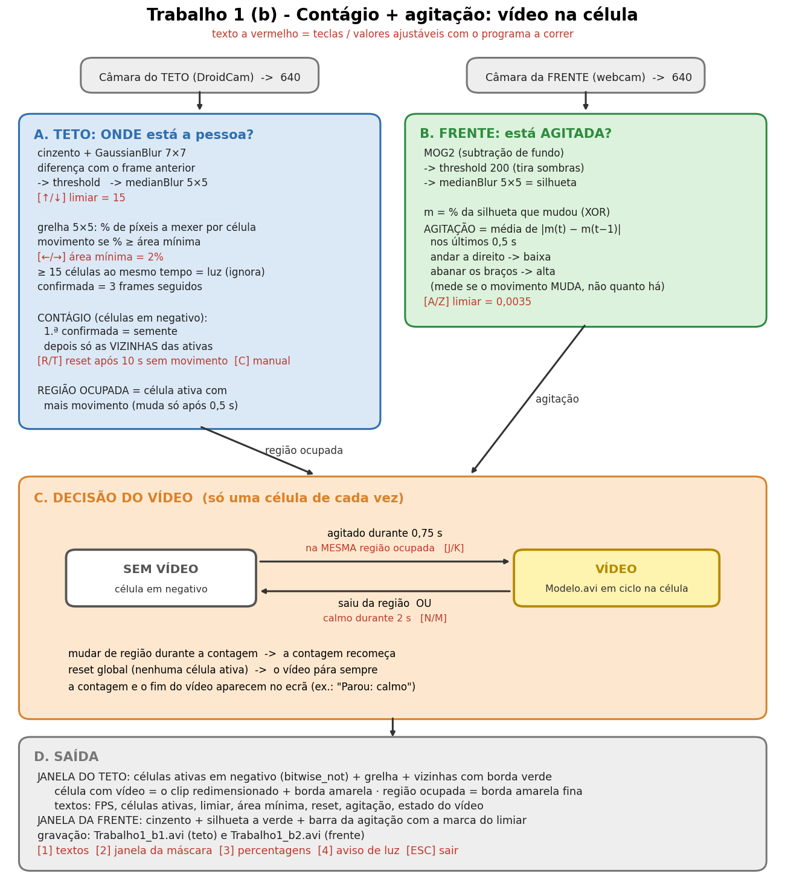

# Esquema do Trabalho 1 (b) — `Trabalho1_b.py`

O processo todo num só esquema: as duas câmaras, como se juntam e quando aparece o vídeo.
A explicação completa está em [EXPLICACAO_Trabalho1_b.md](EXPLICACAO_Trabalho1_b.md).

**Como ler:** `◆ (tecla)` = valor que se ajusta com o programa a correr · `▣` = o que aparece no ecrã · `(A2 s46)` = aula 2, slide 46.

```
 CÂMARA DO TETO (DroidCam) ─► resize 640 de largura (A2 s46)
   │
   ▼
  ╔═══════════════════════════════════════════════════════════════════════════════════════════╗
  ║ A. TETO: "ONDE está a pessoa?"  (parte a, o Trabalho 1)                                   ║
  ║                                                                                           ║
  ║   cinzento + GaussianBlur 7×7 ─► diferença com o frame anterior (valor absoluto)          ║
  ║   ─► threshold ◆(↑/↓) 15 ─► medianBlur 5×5 = máscara de movimento                         ║
  ║   grelha 5×5: % de píxeis a mexer em cada célula                                          ║
  ║   célula com movimento se % ≥ área mínima ◆(←/→) 2%   (≥ 15 células = luz: ignora)        ║
  ║   confirmada = movimento em 3 frames seguidos                                             ║
  ║                                                                                           ║
  ║   CONTÁGIO: sem semente → a confirmada com mais movimento é a semente                     ║
  ║             com semente → só ativam confirmadas VIZINHAS de uma ativa (8 vizinhos)        ║
  ║   RESET: sem movimento durante ◆(R/T) 10 s, ou ◆ C → apaga tudo                           ║
  ║                                                                                           ║
  ║   REGIÃO OCUPADA = a célula ativa com mais movimento (só muda após 0,5 s noutra)          ║
  ╚═══════════════════════════════════════════════════════════════════════════════════════════╝

 CÂMARA DA FRENTE (webcam) ─► resize 640 de largura   (no mesmo ciclo, ao mesmo tempo)
   │
   ▼
  ╔═══════════════════════════════════════════════════════════════════════════════════════════╗
  ║ B. FRENTE: "a pessoa está AGITADA?"  (parte b)                                            ║
  ║                                                                                           ║
  ║   MOG2 (A4 s53) ─► threshold 200 (tira as sombras) ─► medianBlur 5×5 = silhueta           ║
  ║   movimento m = % da silhueta que mudou face ao frame anterior (bitwise_xor, A2 s56)      ║
  ║   AGITAÇÃO = média de |m(t) − m(t−1)| nos últimos 0,5 s                                   ║
  ║      andar a direito → m quase constante → agitação baixa                                 ║
  ║      abanar os braços → m sobe e desce → agitação alta                                    ║
  ║   agitado se agitação ≥ limiar ◆(A/Z) 0,0035                                              ║
  ╚═══════════════════════════════════════════════════════════════════════════════════════════╝
                                               │  região ocupada (A) + agitação (B)
                                               ▼
  ╔═══════════════════════════════════════════════════════════════════════════════════════════╗
  ║ C. DECISÃO DO VÍDEO  (junta A e B · só uma célula de cada vez)                            ║
  ║                                                                                           ║
  ║     ┌───────────────┐  agitado ≥ ◆(J/K) 0,75 s   ┌───────────────────────┐                ║
  ║     │  SEM VÍDEO    │ ─────────────────────────► │  VÍDEO na célula      │                ║
  ║     │ (à espera)    │   na MESMA região ocupada  │  ocupada (em ciclo)   │                ║
  ║     └───────────────┘ ◄───────────────────────── └───────────────────────┘                ║
  ║                        saiu da região, OU                                                 ║
  ║                        calmo durante ◆(N/M) 2 s                                           ║
  ║                                                                                           ║
  ║   mudar de região durante a contagem → a contagem recomeça                                ║
  ║   RESET global (sem células ativas) → o vídeo pára sempre                                 ║
  ╚═══════════════════════════════════════════════════════════════════════════════════════════╝
                                               │
                                               ▼
  ┌───────────────────────────────────────────────────────────────────────────────────────────┐
  │ D. SAÍDA                                                                                  │
  │                                                                                           │
  │   ▣ TETO: células ativas em negativo (bitwise_not) + grelha + vizinhas a verde            │
  │           célula com vídeo = Modelo.avi redimensionado + borda amarela                    │
  │           região ocupada = borda amarela fina · textos: FPS, limiar, área, reset          │
  │   ▣ FRENTE: cinzento + silhueta a verde + barra da agitação com a marca do limiar         │
  │   gravação: Trabalho1_b1.avi (teto) e Trabalho1_b2.avi (frente)                           │
  │   ◆ 1 textos · 2 máscara · 3 percentagens · 4 aviso de luz · ESC sair                     │
  └───────────────────────────────────────────────────────────────────────────────────────────┘
```

## O mesmo esquema em imagem



## Teclas

- **Deteção (teto):** `↑/↓` limiar · `←/→` área mínima · `R/T` tempo de reset · `C` reset manual.
- **Agitação e vídeo:** `A/Z` limiar de agitação · `J/K` tempo mínimo agitado · `N/M` tempo calmo para parar.
- **Vistas:** `1` textos · `2` janela da máscara · `3` percentagens · `4` aviso de luz · `ESC` sair.
