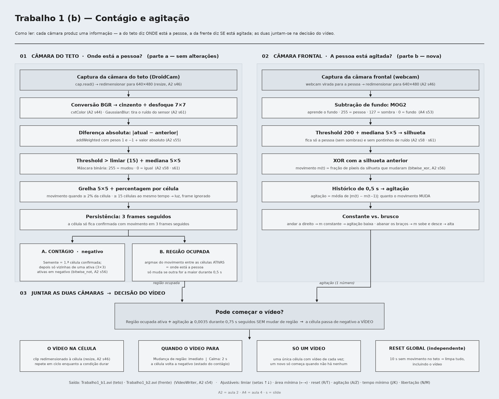

# Trabalho 1 (b) — Contágio e agitação: explicação completa do código

**Ficheiro:** `Trabalho1_b.py` · **Câmara do teto:** DroidCam por Wi-Fi (`CAMERA_SRC`) · **Câmara da frente:** webcam do portátil (`0`) · **Resolução de trabalho:** 640 de largura

Este documento explica o programa **tal como está no código**, pela ordem por que cada imagem passa por ele. Ao lado de cada função do OpenCV está, entre parênteses, a aula e o slide de onde vem. A parte (a) é o Trabalho 1 original, que **não foi alterado**; a parte (b) é o trabalho complementar, acrescentado por cima.

---

## 1. O que o programa faz, numa frase por câmara

O programa usa **duas câmaras ao mesmo tempo**, e cada uma responde a uma pergunta diferente:

- **A câmara do teto responde "ONDE está a pessoa?"** Divide a imagem numa grelha 5×5, deteta em que células há movimento, pinta essas células em negativo segundo a regra do contágio e, a partir disso, sabe em que célula a pessoa está (a **região ocupada**).
- **A câmara da frente responde "a pessoa está AGITADA?"** Separa a pessoa do fundo e mede quão depressa o movimento dela **muda**. Dá um único número, a **agitação**.

O programa junta as duas respostas: **quando a pessoa está agitada durante algum tempo sem mudar de célula, essa célula deixa de estar em negativo e passa a mostrar um vídeo.**

---

## 2. O enunciado da parte (b), traduzido palavra a palavra

> **Trabalho complementar APENAS para os alunos que escolheram (b):**
>
> Acrescentar uma **segunda câmara virada para o utilizador**. A câmara estática (no teto) continua a comandar a grelha, a deteção e a regra de contágio, sem alterações. A partir da câmara frontal, estimar em tempo real um nível de agitação — quão rapidamente o movimento muda ao longo de uma janela curta —, captando movimento rápido e abrupto em vez de deslocamento constante.
>
> **Gatilho.** Se a **agitação exceder o seu limiar** durante uma duração mínima sustentada enquanto a região ocupada não muda, essa **célula passa de negativo para reprodução de vídeo**, um clip redimensionado para caber no quadrante. Todas as outras células comportam-se como antes. O movimento espalha a inversão; a agitação no mesmo sítio abre uma janela. Mover-se depressa e passar para uma nova região não dispara a reprodução — a mudança de região reinicia a condição.
>
> **Comportamento.** A reprodução mantém-se enquanto a condição se mantiver e repete em ciclo se durar mais do que o clip. **Ao sair da região, ou quando a agitação descer abaixo do limiar** durante um intervalo de libertação definido, a **célula volta ao normal**. Só uma célula pode estar a reproduzir de cada vez; o reset global de 10 segundos sobrepõe-se a tudo.

---

## 3. Esquema completo



### 3.1 O caminho das duas imagens

```
   CÂMARA DO TETO (DroidCam)                                    CÂMARA DA FRENTE (webcam)
   ─────────────────────────                                    ─────────────────────────
   cap.read()                    (aula 2, slide 50)             cap_frente.read()
        │                                                             │
   redimensionar → 640×480       (cv2.resize, aula 2, slide 46)  redimensionar → 640×480
        │                                                             │
   ┌────┴──────────── PARTE (a) ───────────────┐            ┌────────┴──────── PARTE (b) ────────┐
   │ cinzento     (cv2.cvtColor, a2 s44)       │            │ MOG2.apply → frente/sombra/fundo    │
   │ desfoque 7×7 (cv2.GaussianBlur, a2 s61)   │            │            (aula 4, slide 53)       │
   │      │                                    │            │ threshold 200 → só a frente (a2 s58)│
   │ |atual − anterior| (cv2.addWeighted, s55) │            │ medianBlur 5 → silhueta   (a2 s61)  │
   │ threshold limiar → máscara (a2 s58)       │            │      │                              │
   │ medianBlur 5 → máscara limpa (a2 s61)     │            │ silhueta XOR silhueta anterior      │
   │      │                                    │            │      (cv2.bitwise_xor, a2 s56)      │
   │ % de píxeis brancos por célula (5×5)      │            │ movimento m(t) = fração que mudou   │
   │ ≥ área mínima? ≥ 15 células? (luz)        │            │      │                              │
   │ 3 frames seguidos? (persistência)         │            │ agitação = média |m(t) − m(t−1)|    │
   │ semente / vizinhas 3×3 (contágio)         │            │   nos últimos 0,5 s                 │
   │ 10 s sem movimento → reset                │            └────────────────┬────────────────────┘
   └────┬──────────────────────────┬───────────┘                             │
        │ ativas (5×5)             │ frac (5×5)                              │ agitação (1 número)
        │                          ▼                                         │
        │            REGIÃO OCUPADA: a célula ativa com mais                 │
        │            movimento (só muda se outra for a maior                 │
        │            durante 0,5 s seguidos)                                 │
        │                          │                                         │
        │                          ▼                                         ▼
        │            ┌──────────── DECISÃO DO VÍDEO (máquina de estados) ──────────────┐
        │            │ agitação ≥ limiar, na mesma célula, durante 0,75 s → VÍDEO       │
        │            │ VÍDEO: sai da célula → para logo                                 │
        │            │        agitação < limiar durante 2 s → para                      │
        │            │ reset global → para tudo                                         │
        │            └────────────────────────────────┬─────────────────────────────────┘
        ▼                                             │ celula_video
   IMAGEM DE SAÍDA (sempre uma cópia do frame)        │
   negativo nas ativas (cv2.bitwise_not, a2 s56) ◄────┘ + na célula do vídeo: clip redimensionado
   grelha + elegíveis (cv2.polylines, a2 s63)             (cv2.resize, a2 s46)
   texto (cv2.putText, a2 s63)
        │                                                             │
   imshow "Contagion" + gravação Trabalho1_b1.avi           imshow "Camara da frente" + gravação Trabalho1_b2.avi
   (cv2.imshow a2 s38; cv2.VideoWriter a2 s54)               (silhueta a verde + barra da agitação)
```

### 3.2 O ciclo principal (uma volta do `while` por frame)

```
 ┌─ 1. Captura e redimensionamento da câmara do teto            parte (a)
 ├─ 2. FPS (frames contados a cada 0,5 s)                        parte (a)
 ├─ 3. Deteção de movimento (diferença entre frames)             parte (a)
 ├─ 3b. Câmara da frente → silhueta (MOG2) → agitação            parte (b)
 ├─ 4. Decisão por célula (área mínima + rejeição global)        parte (a)
 ├─ 5. Contágio (persistência + semente + vizinhos)              parte (a)
 ├─ 6. Reset automático (10 s sem movimento)                     parte (a)
 ├─ 6b. Região ocupada + decisão do vídeo                        parte (b)
 ├─ 7. Imagem de saída: negativo, grelha, elegíveis, VÍDEO        (a) + (b)
 ├─ 8. Texto: FPS, limiar, área, reset, AGITAÇÃO, estado do vídeo (a) + (b)
 ├─ 9. Gravação das duas câmaras                                 (a) + (b)
 ├─ 10. Mostrar as janelas                                       (a) + (b)
 └─ 11. Teclado                                                  (a) + (b)
```

### 3.3 A máquina de estados do vídeo

```
                         agitação ≥ limiar e região ocupada não muda
              ┌──────────────────────────────────────────────────────┐
              │                                                      ▼
   ┌─────────────────────┐   agitação ≥ limiar    ┌───────────────────────────┐
   │ SEM VÍDEO           │ ─────────────────────> │ A CONTAR ("Agitado: x s") │
   │ (célula em negativo)│ <───────────────────── │ t_inicio_agitacao         │
   └─────────────────────┘  agitação < limiar,    └─────────────┬─────────────┘
         ▲      ▲           ou mudou de região                  │ passou t_agitacao_min (0,75 s)
         │      │           (a contagem recomeça)               ▼
         │      │                                  ┌───────────────────────────┐
         │      └── saiu da região (logo) ──────── │ VÍDEO na célula ocupada   │
         │      └── agitação < limiar 2 s ──────── │ (o clip repete em ciclo)  │
         │                                         └───────────────────────────┘
         └──── reset global (nenhuma célula ativa): para tudo, em qualquer estado
```

Só existe **uma** variável para a célula com vídeo (`celula_video`), por isso nunca pode haver dois vídeos ao mesmo tempo. Um vídeo novo só pode começar quando `celula_video` está vazia.

---

## 4. Antes do ciclo

**Parâmetros** (topo do ficheiro): todos os números afináveis, agrupados por etapa. Os da parte (a) são os do Trabalho 1; os da parte (b) estão no bloco "PARTE (b)" (ver a secção 8).

**Variáveis globais:** a memória do programa entre frames. Da parte (a): a frame anterior, as matrizes `ativas` e `persist` (5×5), a semente, o instante do último movimento. Da parte (b): o subtrator de fundo `mog2`, a silhueta anterior, o histórico do movimento, a região ocupada e a candidata, a célula com vídeo e os instantes que contam os tempos.

**As câmaras:**
- a do teto é aberta pelo endereço do DroidCam (`cv2.VideoCapture`, aula 2, slide 50). Como é por Wi-Fi e a primeira ligação às vezes falha, o programa tenta **3 vezes**, com 2 s entre tentativas;
- a da frente é a webcam do portátil (`cv2.VideoCapture(0)`). O programa precisa sempre das duas câmaras.

**O vídeo da célula:** é aberto com `cv2.VideoCapture` a partir do ficheiro `Modelo.avi` (gravado com a prática 9 da aula 2). Se o ficheiro não existir, a célula mostra uma **animação de teste** (uma cor a mudar com a palavra "VIDEO"), para o programa poder ser testado sem o vídeo.

---

## 5. Parte (a): a câmara do teto (o Trabalho 1, sem alterações)

### 5.1 Captura, redimensionamento e FPS

- `cap.read()` pede um frame à câmara do teto. Se falhar, o programa termina.
- `redimensionar()` usa o `cv2.resize` com `INTER_AREA` (aula 2, slide 46) para pôr a imagem com 640 de largura, mantendo a proporção. Tudo o resto trabalha em 640×480.
- `limites_grelha()` calcula as coordenadas das fronteiras das 25 células (0, 128, 256… na horizontal; 0, 96, 192… na vertical).
- O **FPS** é o número de frames contados a dividir pelo tempo, recalculado a cada 0,5 s.

### 5.2 Deteção de movimento: a máscara

1. **Cinzento** (`cv2.cvtColor`, aula 2, slide 44): o movimento é uma mudança de brilho; a cor não é precisa, e um canal é mais rápido do que três.
2. **Desfoque gaussiano 7×7** (`cv2.GaussianBlur`, aula 2, slide 61): suaviza o ruído do sensor e da compressão, para dois frames iguais não terem diferenças só por ruído.
3. **Diferença absoluta entre o frame atual e o anterior** (`cv2.addWeighted` com pesos 1 e −1, aula 2, slide 55, seguido de valor absoluto): um píxel que não mudou dá 0; um píxel que mudou dá um valor alto. Faz o mesmo que o `absdiff`.
4. **Limiar de sensibilidade** (`cv2.threshold`, aula 2, slide 58): acima do limiar (15 por defeito) o píxel fica **branco** (movimento); abaixo fica **preto**. É este o valor das **setas cima/baixo**: mais baixo, mais sensível (apanha movimentos pequenos e ruído); mais alto, menos sensível.
5. **Filtro de mediana 5×5** (`cv2.medianBlur`, aula 2, slide 61): apaga píxeis brancos isolados (ruído que passou o limiar) e deixa os aglomerados, que é o que interessa (movimento real).

### 5.3 Decisão por célula

- `fracao_por_celula()` conta, em cada uma das 25 células, a **percentagem de píxeis brancos** da máscara.
- `decidir_movimento()` diz que uma célula **tem movimento** se essa percentagem for pelo menos a **área mínima** (2% por defeito, setas esquerda/direita). Assim, um bocadinho de ruído numa célula não conta.
- **Rejeição global:** se **15 ou mais** células tiverem movimento ao mesmo tempo, não é uma pessoa — é a luz ou a exposição da câmara a mudar. O frame inteiro é ignorado.

### 5.4 Contágio

- **Persistência:** uma célula só fica **confirmada** se tiver movimento em **3 frames seguidos**. Movimentos de um único frame (um piscar de luz) não contam.
- **Semente:** enquanto nenhuma célula está ativa, a primeira célula confirmada (a com mais movimento) torna-se a semente e fica em negativo.
- **Elegíveis:** depois da semente, só podem ser ativadas as células **vizinhas** (na janela 3×3, vizinhança de 8) de uma célula já ativa. O movimento noutras células é ignorado. As elegíveis têm uma **borda verde**.
- As células ativas **nunca são desativadas** pelo contágio; só o reset as apaga.

### 5.5 Reset

Se passarem **10 s sem nenhum movimento válido** em toda a imagem (teclas `R`/`T` para mudar o intervalo), todas as células voltam ao normal e a semente desaparece. A tecla `C` faz o mesmo à mão.

### 5.6 A imagem de saída

- É sempre uma **cópia** do frame, para os desenhos nunca entrarem na deteção do frame seguinte.
- As células ativas mostram o **negativo** do frame ao vivo (`cv2.bitwise_not`, aula 2, slide 56: 255 − valor).
- A grelha e as bordas das elegíveis são desenhadas com `cv2.polylines` (aula 2, slide 63).

---

## 6. Parte (b): a câmara da frente e a agitação

### 6.1 A silhueta da pessoa — subtração de fundo (MOG2)

**Onde:** no ciclo principal, passo 3b (já não é uma função à parte) · **Funções do OpenCV:** `cv2.createBackgroundSubtractorMOG2` e `.apply` (aula 4, slide 53), `cv2.threshold` (aula 2, slide 58), `cv2.medianBlur` (aula 2, slide 61).

O MOG2 vai **aprendendo como é o fundo** da câmara da frente (a parede, a cadeira, os móveis) e, em cada frame, marca o que é **diferente** desse fundo — a pessoa. Devolve uma imagem com três valores: **255** onde há "frente" (a pessoa), **127** onde há **sombras**, e **0** no fundo.

- `history = 300`: o MOG2 lembra-se dos últimos ~300 frames (~10 s). O que ficar parado mais do que isso passa a ser fundo.
- `varThreshold = 50`: quão diferente do fundo tem de ser um píxel para ser "frente".
- `detectShadows = True`: as sombras ficam marcadas à parte (127).

Depois, o `threshold` em 200 fica só com o **255** (a sombra da pessoa na parede não conta), e a **mediana 5×5** apaga os pontinhos de ruído. O resultado é a **silhueta**: branco onde está a pessoa, preto no resto.

**Porquê o MOG2 aqui** (e não a diferença entre frames como no teto): o professor disse que nesta parte se podia usar a subtração de fundo, e ela dá a **forma** da pessoa inteira, e não só as bordas do que se mexeu. A agitação mede como essa forma **muda**, por isso uma silhueta completa é mais estável do que os contornos da diferença entre frames. A parte (a) continua com a diferença entre frames, sem alterações, como o enunciado pede.

**Um cuidado:** o MOG2 precisa de uns segundos para aprender o fundo. Se o programa arrancar com a pessoa já à frente da câmara, ao início vê-a toda como silhueta; ao fim de alguns segundos estabiliza.

### 6.2 O movimento de cada frame

**Função:** `medir_agitacao()` · **Função do OpenCV:** `cv2.bitwise_xor` (aula 2, slide 56).

O `bitwise_xor` entre a silhueta atual e a anterior dá branco **onde a silhueta mudou**: píxeis que eram pessoa e deixaram de ser, ou ao contrário. O **movimento** do frame, `m(t)`, é a **fração** desses píxeis na imagem toda:

```
 silhueta anterior     silhueta atual        XOR (mudou)
 . . # # . .           . . . # # .           . . # . # .
 . . # # . .     →     . . . # # .     →     . . # . # .      m(t) = píxeis brancos / total
 . . # # . .           . . . # # .           . . # . # .
```

### 6.3 A agitação: quanto o movimento MUDA

O enunciado pede "**quão rapidamente o movimento muda**", e não "quanto movimento há". Por isso a agitação não é o `m(t)`, mas a **variação** do `m(t)`:

```
 agitação = média de |m(t) − m(t−1)| nos últimos 0,5 s
```

O programa guarda um histórico dos valores de `m` do último meio segundo (`JANELA_AGITACAO`) e faz a média das diferenças entre valores seguidos.

**Porque é que isto separa o movimento brusco do deslocamento constante:**

```
 deslocamento constante (andar a direito):   m = 0,030  0,031  0,030  0,029  0,030
                                              diferenças:  0,001  0,001  0,001  0,001   → agitação ≈ 0,001 (baixa)

 abanar os braços (brusco, irregular):        m = 0,010  0,045  0,008  0,052  0,015
                                              diferenças:  0,035  0,037  0,044  0,037   → agitação ≈ 0,038 (alta)
```

Num deslocamento constante a silhueta muda **sempre o mesmo tanto**, por isso `m` quase não varia. A abanar, a silhueta muda muito num frame e pouco no seguinte, e `m` sobe e desce. Num teste com formas sintéticas: parado → 0,0000; deslocamento constante → 0,0000; a abanar → 0,0216.

**Porquê 0,5 s de janela:** é "uma janela curta", como o enunciado diz. Mais longa, a agitação reagiria devagar; mais curta, ficaria muito sensível a um único frame com ruído.

### 6.4 A região ocupada (vem da câmara do teto)

**Função:** `celula_ocupada()` + a lógica do passo 6b.

A câmara da frente não sabe nada da grelha. **O "onde" vem da câmara do teto**: a região ocupada é a **célula ativa com mais movimento** nesse frame (`np.argmax` sobre a percentagem de movimento, só nas células ativas e com movimento acima da área mínima).

**Porquê só as células ativas:** o vídeo substitui o **negativo** da célula ("passa de negativo para reprodução de vídeo"), por isso só uma célula já contagiada pode ter vídeo.

**A região só muda se outra célula for a de mais movimento durante 0,5 s seguidos** (`T_TROCA_REGIAO`). Ao abanar os braços, a câmara do teto vê movimento também nas células vizinhas; sem este atraso, bastava um instante com o braço na célula do lado para o programa achar que a pessoa tinha mudado de sítio (e o vídeo parava). Andar mesmo para outra célula dura mais do que meio segundo.

Se nenhuma célula ativa tiver movimento num frame (a pessoa está quieta), a região ocupada **mantém-se**. Se a célula deixar de estar ativa (reset), deixa de haver região ocupada.

### 6.5 A decisão do vídeo (passo 6b)

A lógica segue a máquina de estados da secção 3.3:

1. **Reset global primeiro:** se nenhuma célula estiver ativa, não há vídeo nem contagem. É o "o reset global sobrepõe-se a tudo".
2. **Sem vídeo — a contar:** se há região ocupada e a agitação está **acima do limiar**, começa (ou continua) a contagem `t_inicio_agitacao`. Se a região ocupada **mudar** a meio, a contagem **recomeça** na nova célula — é o "mover-se depressa e passar para uma nova região não dispara a reprodução". Se a agitação cair abaixo do limiar, a contagem também recomeça (a duração mínima tem de ser **seguida**). Quando a contagem chega a `t_agitacao_min` (**0,75 s**), a célula passa a ter **vídeo**, e o clip volta ao início.
3. **Com vídeo:**
   - se a região ocupada **mudar**, o vídeo para **logo** ("ao sair da região");
   - se a agitação ficar **abaixo do limiar**, começa a contar `t_abaixo`; se voltar a subir antes do fim, a contagem é cancelada; se chegar a `t_libertar` (**2 s**), o vídeo para ("intervalo de libertação");
   - quando para, fica guardado o **motivo**, que aparece no ecrã durante 2 s ("Parou: saiu da regiao" ou "Parou: calmo 2.0s").

**Quando o vídeo para, a célula volta a negativo.** O enunciado diz "volta ao normal"; a interpretação escolhida é voltar ao **estado do contágio**, porque (1) o enunciado diz que a célula passou "**de negativo** para vídeo", (2) a regra do contágio continua "sem alterações" e o vídeo é só uma camada por cima, e (3) só o reset global limpa o contágio.

**O vídeo dura o que a condição durar**, e não o tamanho do clip: se a agitação continuar mais do que o clip, ele **repete** do início; se parar antes, o vídeo é interrompido ("a reprodução mantém-se enquanto a condição se mantiver").

### 6.6 O vídeo na célula

**Função:** `frame_do_clip()` · **Funções do OpenCV:** `cv2.VideoCapture.read`, `cv2.resize` (aula 2, slide 46).

Em cada frame do programa lê-se **um** frame do clip e redimensiona-se para o tamanho exato da célula (128×96), que é colado na imagem de saída **por cima do negativo**, com uma borda amarela grossa. Quando o clip acaba, `CAP_PROP_POS_FRAMES = 0` volta ao início (ciclo). Como se lê um frame do clip por frame do programa, o clip passa à velocidade do programa (~30 FPS).

### 6.7 A janela da câmara da frente

**Função:** `vista_frente()`.

Mostra a imagem da frente em cinzento com a **silhueta a verde**, e em baixo uma **barra** com a agitação: a barra cheia corresponde a 4× o limiar, e uma **marca branca** indica o limiar. A barra fica **vermelha** acima do limiar e **verde** abaixo. Serve para afinar o limiar no momento e para mostrar ao professor o que o programa está a medir.

### 6.8 O que aparece na janela principal (parte b)

- **Borda amarela fina:** a região ocupada (onde a pessoa está).
- **Borda amarela grossa + vídeo:** a célula com vídeo.
- Em cima à direita: **"Agitacao (A/Z): x / limiar"** (amarelo acima do limiar, vermelho abaixo); o **estado** ("Sem video", "Agitado: 0,4/0,75 s", "VIDEO", "VIDEO (para em 1,2 s)", ou o motivo da paragem); e os tempos mínimo e de libertação.

### 6.9 A gravação das duas câmaras

Com o `cv2.VideoWriter` (aula 2, slide 54), em XVID, ao FPS medido:
- `Trabalho1_b1.avi` — a janela principal (câmara do teto);
- `Trabalho1_b2.avi` — a janela da câmara da frente.

Os ficheiros só são criados depois de duas medições do FPS (a primeira inclui o atraso da ligação à câmara) e são fechados com `release()` ao sair com o **ESC** — fechar de outra forma pode deixá-los corrompidos.

---

## 7. Porquê estas escolhas (para a explicação oral)

- **A parte (a) ficou intacta** porque o enunciado diz que a câmara do teto "continua a comandar a grelha, a deteção e a regra de contágio, **sem alterações**". A parte (b) só **lê** dela a matriz das ativas e a percentagem de movimento por célula.
- **MOG2 na câmara da frente:** dá a silhueta completa da pessoa (e não só as bordas do que se mexeu), separa as sombras, e o professor indicou que nesta parte se podia usar a subtração de fundo.
- **Agitação = variação do movimento, e não quantidade de movimento:** é a definição do enunciado ("quão rapidamente o movimento muda"). Medir só a quantidade confundiria andar a direito (muito movimento, constante) com abanar os braços.
- **`bitwise_xor` entre silhuetas:** mede exatamente "quanto da silhueta mudou de um frame para o outro", com uma função dada (aula 2, slide 56).
- **Janela de 0,5 s:** curta, como pedido, mas com vários valores para a média não depender de um único frame.
- **Região ocupada = célula ativa com mais movimento:** a câmara do teto já mede o movimento por célula; a pessoa está onde há mais movimento. Só células ativas, porque o vídeo substitui o negativo.
- **0,5 s para mudar de região:** sem isto, os braços a entrar na célula do lado paravam o vídeo (visto nos testes).
- **0,75 s de agitação para abrir e 2 s para fechar:** o primeiro é curto o suficiente para reagir, mas ignora um gesto isolado (coçar a cabeça); o segundo deixa o vídeo aguentar pausas curtas na agitação.
- **Tempos em segundos e não em frames:** o comportamento não muda se o FPS cair (por exemplo, com o Wi-Fi do DroidCam lento).
- **Uma só variável para a célula com vídeo:** garante, pela forma do código, que nunca há dois vídeos.

---

## 8. Parâmetros e o seu efeito

### Parte (a) — câmara do teto
- **Limiar de sensibilidade** (15; setas cima/baixo, passo 5) — a diferença mínima de brilho para um píxel ser movimento. Mais baixo: apanha movimentos pequenos e ruído. Mais alto: só mudanças fortes.
- **Área mínima** (2%; setas esquerda/direita, passo 0,5%) — percentagem da célula com movimento para a célula contar. Mais baixa: um gesto pequeno ativa a célula. Mais alta: só movimento grande.
- **Células para mudança global** (15) — acima disto o frame é ignorado (luz).
- **Persistência** (3 frames) — frames seguidos com movimento para uma célula ficar confirmada.
- **Intervalo de reset** (10 s; `R`/`T`, passo 1 s) — tempo sem movimento até tudo voltar ao normal.

### Parte (b) — câmara da frente e vídeo
- **Limiar de agitação** (0,0035; `A`/`Z`, passo 0,001) — mais baixo: movimentos suaves já contam como agitação (risco de disparar sem querer). Mais alto: é preciso agitar-se mais.
- **Tempo mínimo de agitação** (0,75 s; `J`/`K`, passo 0,25 s) — mais baixo: o vídeo abre mais depressa, mas um gesto isolado pode abri-lo. Mais alto: é preciso agitar-se mais tempo.
- **Tempo de libertação** (2 s; `N`/`M`, passo 0,5 s) — mais baixo: o vídeo para pouco depois de acalmar. Mais alto: aguenta pausas maiores.
- **Tempo para mudar de região** (0,5 s; fixo no código) — mais baixo: os braços a passar para a célula do lado param o vídeo. Mais alto: demora a perceber que a pessoa mudou mesmo de sítio.
- **Janela da agitação** (0,5 s; fixo) — o "curto período" em que se mede a variação.
- **MOG2:** memória de 300 frames, limiar 50, sombras detetadas (fixos).

---

## 9. Teclas

**Parte (a):** `ESC` sair · `1` textos · `2` janela da máscara · `3` percentagens por célula · `4` aviso de mudança global de luz · `C` reset manual · `R`/`T` intervalo de reset · setas cima/baixo limiar · setas esquerda/direita área mínima.

**Parte (b):** `A`/`Z` limiar de agitação · `J`/`K` tempo mínimo de agitação · `N`/`M` tempo de libertação.

As teclas só funcionam com uma das janelas do programa selecionada.

---

## 10. Limitações a referir

- **O MOG2 precisa de aprender o fundo:** nos primeiros segundos, ou se a câmara da frente se mexer, a silhueta não é fiável. Uma pessoa completamente parada durante mais de ~10 s começa a ser absorvida pelo fundo (o que não afeta a agitação, que só interessa quando há movimento).
- **Mudanças de luz na câmara da frente** (ligar uma luz) aparecem como uma grande mudança da silhueta e podem dar um pico de agitação. Como o vídeo exige 0,75 s **seguidos**, um pico isolado não o abre.
- **A região ocupada depende de a pessoa estar a mexer-se na câmara do teto;** se estiver na fronteira entre duas células, a região pode trocar (o atraso de 0,5 s reduz isto).
- **O DroidCam por Wi-Fi** pode ter atraso ou falhar a ligação; o programa tenta 3 vezes. Por USB é mais estável.
- **O clip passa à velocidade do programa** (um frame do clip por frame do programa).
