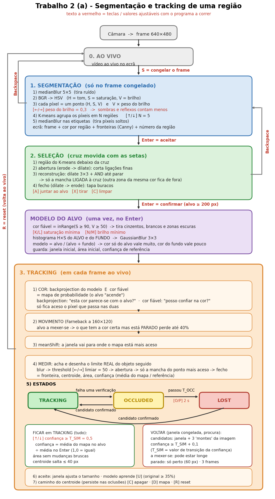

# Esquema do Trabalho 2 (a) — `Trabalho2_a.py`

O processo todo num só esquema, do frame da câmara até ao caminho desenhado.
Os pormenores de cada parte estão no [ROADMAP.md](ROADMAP.md) (secção 11).

**Como ler:** `◆ (tecla)` = valor que se ajusta com o programa a correr · `▣` = o que aparece no ecrã · `(A2 s44)` = aula 2, slide 44.

```
 CÂMARA ──► frame BGR ──► resize 640×480 (A2 s46)
   │
   │  ╔═══════════════════════════════════════════════════════════════════════════════════════════╗
   │  ║ 0. AO VIVO        ▣ vídeo ao vivo                                                         ║
   │  ╚═══════════════════════════════════════╤═══════════════════════════════════════════════════╝
   │                                          │ S = congelar o frame
   │                                          ▼
   │  ╔═══════════════════════════════════════════════════════════════════════════════════════════╗
   │  ║ 1. SEGMENTAÇÃO  (só no frame congelado; refaz quando se muda N ou o peso)                 ║
   │  ║                                                                                           ║
   │  ║   medianBlur 5×5 (A2 s61) ─► BGR→HSV (A2 s44) ─► Z = uma linha por píxel (H, S, V)        ║
   │  ║   ─► V × peso do brilho ◆(←/→) 0,3    (sombras e reflexos contam menos)                   ║
   │  ║   ─► kmeans(Z, N) ◆(↑/↓) N = 5  (A4 s43–44) ─► etiquetas + medianBlur 5×5 (píxeis soltos) ║
   │  ║                                                                                           ║
   │  ║   ▣ frame + cor por região (addWeighted) + fronteiras (Canny) + n.º de cada região        ║
   │  ╚═══════════════════════════════════════╤═══════════════════════════════════════════════════╝
   │                    Backspace = voltar ◄──┤ Enter = aceitar
   │                                          ▼
   │  ╔═══════════════════════════════════════════════════════════════════════════════════════════╗
   │  ║ 2. SELEÇÃO  (cruz movida com as setas)                                                    ║
   │  ║                                                                                           ║
   │  ║   região debaixo da cruz ─► abertura (corta ligações finas)                               ║
   │  ║   ─► reconstrução: dilate 3×3 + AND até parar = só a mancha LIGADA à cruz (A4 s47)        ║
   │  ║   ─► fecho (tapa buracos)                                                                 ║
   │  ║   ◆ A = juntar ao alvo · X = tirar · C = limpar                                           ║
   │  ║                                                                                           ║
   │  ║   ▣ frame a cinzento + mancha/alvo com as cores reais + cruz                              ║
   │  ╚═══════════════════════════════════════╤═══════════════════════════════════════════════════╝
   │                    Backspace = voltar ◄──┤ Enter = confirmar (alvo ≥ 200 px)
   │                                          ▼
   │  ┌───────────────────────────────────────────────────────────────────────────────────────────┐
   │  │ MODELO DO ALVO  (uma vez, no Enter)                                                       │
   │  │                                                                                           │
   │  │   cor fiável = inRange(S ≥ 90, V ≥ 50) (A2 s59) ◆(K/L, N/M)  ─ tira cinzentos e escuros   │
   │  │   histograma H×S do ALVO e do FUNDO (calcHist, A4 s22) ─► GaussianBlur 3×3                │
   │  │   modelo = alvo / (alvo + fundo) ─► normalize 0–255                                       │
   │  │      (cor só do alvo ≈ 255 · cor que também está no fundo ≈ baixa)                        │
   │  │   janela inicial = retângulo do alvo · área inicial · confiança de referência             │
   │  └───────────────────────────────────────┬───────────────────────────────────────────────────┘
   │                                          ▼
   │  ╔═══════════════════════════════════════════════════════════════════════════════════════════╗
   └─►║ 3. TRACKING  (em cada frame AO VIVO)                                                      ║
      ║                                                                                           ║
      ║   ① COR:  backprojection do modelo (calcBackProject, A4 s54) E cor fiável                 ║
      ║           = mapa de probabilidade (o alvo "acende")                                       ║
      ║           backprojection = "esta cor parece-se com o alvo?" (usa o histograma)            ║
      ║           cor fiável     = "posso confiar na cor deste píxel?" (S e V mínimos)            ║
      ║           só fica aceso o píxel que passa nas duas                                        ║
      ║   ② MOVIMENTO:  Farneback a 160×120 (A4 s57–58) ─► deslocamento > 1 px ─► zona            ║
      ║           se o alvo se mexe: o que tem a cor certa mas está PARADO perde até 40%          ║
      ║   ③ meanShift (A4 s54) ─► a janela vai para onde o mapa está mais aceso                   ║
      ║   ④ MEDIR: acha e desenha o limite REAL do objeto seguido (dentro da janela + 25%)        ║
      ║           blur ─► threshold ◆(←/→) 50 ─► abertura ─► mancha do ponto mais aceso ─► fecho  ║
      ║           = fronteira · centroide · área · confiança (média do mapa / referência)         ║
      ║                                                                                           ║
      ║   ⑤ ESTADOS                                                                               ║
      ║                                                                                           ║
      ║     ┌──────────────┐  falha uma verificação ┌──────────────┐  passou T_OCC ┌──────────┐   ║
      ║     │  TRACKING    │ ─────────────────────► │  OCCLUDED    │ ────────────► │  LOST    │   ║
      ║     │  (verde)     │                        │  (amarelo)   │  ◆(O/P) 2 s   │(vermelho)│   ║
      ║     └──────────────┘ ◄───────────────────── └──────────────┘               └────┬─────┘   ║
      ║            ▲           candidato confirmado                                     │         ║
      ║            └──────────────────────────── candidato confirmado ─────────────────┘          ║
      ║                                                                                           ║
      ║      FICAR em TRACKING, tem de passar em tudo:                                            ║
      ║        confiança ≥ T_SIM ◆(↑/↓) 0,5 · área sem mudanças bruscas · centroide salta ≤ 40 px ║
      ║        confiança = média do mapa no alvo / média de referência   (1,0 = igual à seleção)  ║
      ║        média de referência = a média no Enter (acompanha o modelo quando aprende)         ║
      ║                                                                                           ║
      ║      VOLTAR (em OCCLUDED/LOST a janela fica congelada e procura-se):                      ║
      ║        candidatos = janela congelada + 3 "montes" da imagem (blur grande + minMaxLoc)     ║
      ║        aceite se: confiança ≥ T_SIM + 0,1 e área razoável                                 ║
      ║                   (T_SIM é o valor de transição da confiança)                             ║
      ║                   A MEXER-SE → pode estar longe · PARADO → só perto (60 px)               ║
      ║                   e no mesmo sítio 3 frames seguidos                                      ║
      ║                                                                                           ║
      ║   ⑥ SE ACEITE:  janela ajusta o tamanho ao objeto (até 3× a inicial)                      ║
      ║                 modelo APRENDE ◆(U): 15% das cores atuais (só píxeis a mexer-se),         ║
      ║                 o original nunca abaixo de 35%                                            ║
      ║                                                                                           ║
      ║   ⑦ CAMINHO: linha do centroide anterior ao atual (cv2.line, A4 s59)                      ║
      ║              persiste nas oclusões e volta a ligar quando o alvo reaparece  ◆ C = apagar  ║
      ║                                                                                           ║
      ║   ▣ frame ao vivo + caminho + fronteira + janela na cor do estado + centroide + ESTADO    ║
      ║   ▣ D = janela do mapa de probabilidade (2.º D: + vetores do Farneback)                   ║
      ╚═══════════════════════════════════════════════════════════════════════════════════════════╝
                                    R = reset (volta ao AO VIVO)

 Em todos os modos: a janela principal é gravada em Trabalho_2.avi (VideoWriter, A2 s54) · 1 = textos · ESC = sair
```

## O mesmo esquema em imagem



## Teclas

- **AO VIVO:** `S` congelar o frame.
- **SEGMENTAÇÃO:** `↑/↓` ou `+/−` N regiões · `←/→` peso do brilho · `S` outro frame · `Enter` aceitar · `Backspace` voltar ao vivo.
- **SELEÇÃO:** setas mover a cruz · `A` juntar · `X` tirar · `C` limpar · `Enter` confirmar · `Backspace` voltar à segmentação.
- **TRACKING:** `←/→` limiar de probabilidade · `↑/↓` limiar de semelhança (`T_SIM`) · `O/P` tempo até LOST (`T_OCC`) · `K/L` saturação mínima · `N/M` brilho mínimo · `F` movimento · `U` aprender · `D` mapa · `C` apagar caminho · `R` reset.
- **Sempre:** `1` textos · `ESC` sair.
