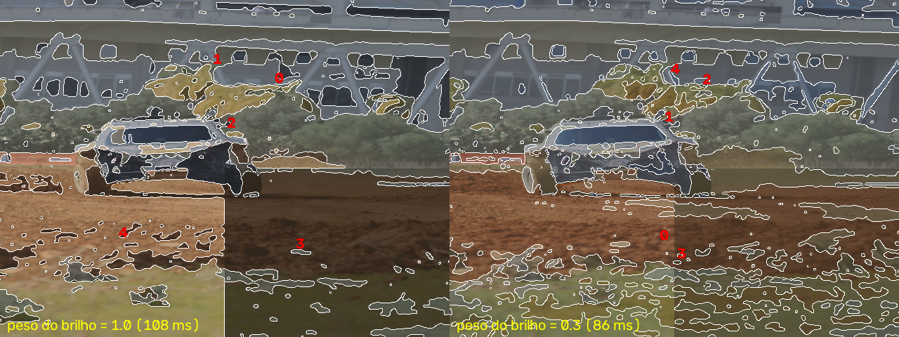
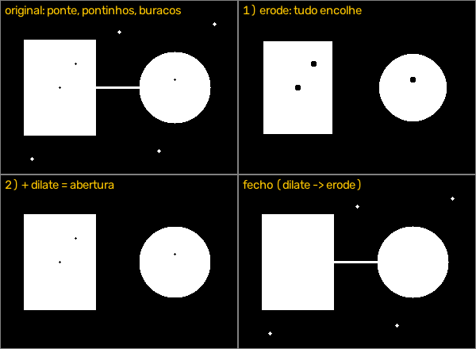
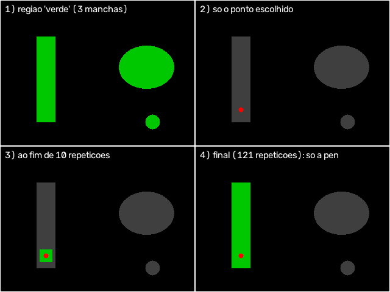
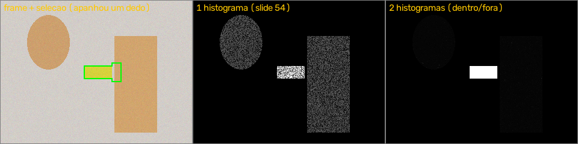
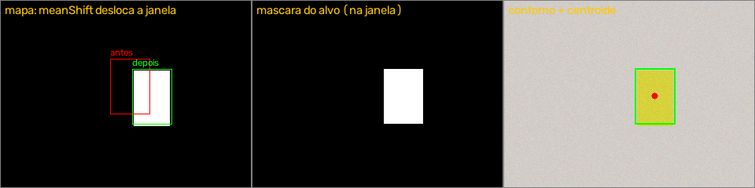
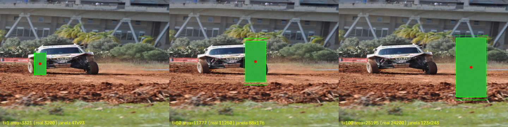
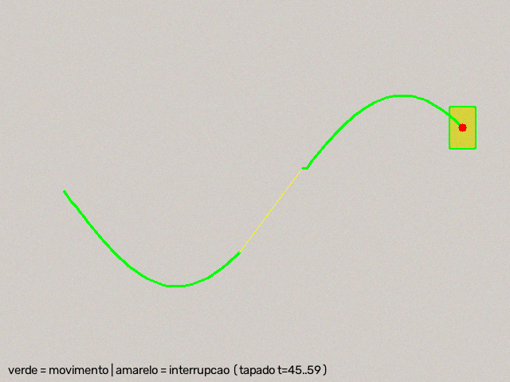

# Roadmap: Trabalho 2 (a) — Breadcrumb: seguimento de uma região com caminho persistente

**Ficheiro:** `Trabalho2_a.py` · **Câmara:** webcam do portátil (`VideoCapture(0)`) ou DroidCam por IP · **Resolução de trabalho:** 640 de largura · **Apresentação:** segunda, 26/10/2026, 19h

📐 O **esquema completo e atualizado** (fases, ciclo, estados, onde entra cada dado ajustável e de onde vem cada janela) está em **[ESQUEMA.md](ESQUEMA.md)**. A explicação passo a passo está na **secção 11** e o histórico das correções na **secção 11.9**.

---

## 0. Decisões tomadas

| Tema | Decisão |
|---|---|
| Base do código | **reaproveitar o Trabalho 1**: `redimensionar()`, funções de texto, medição do FPS a cada 0,5 s, teclas com `waitKeyEx`, gravação com `VideoWriter` |
| Tamanho da janela | **processamento em 640×480**; a janela é maior só na visualização: `namedWindow(WINDOW_NORMAL \| WINDOW_KEEPRATIO)` + `resizeWindow` com `ESCALA_JANELA = 1.5` (aula 2, slide 41). No Windows o `WINDOW_KEEPRATIO` é ignorado: esticar a janela com o rato deforma a imagem (aceite). A gravação continua em 640×480 |
| Restrição | **só métodos dados nas aulas** (aula 2 e aula 4). Funções fora dos slides só se forem interface (ver secção 9) |
| Segmentação | **K-means só com a cor, em HSV** (aula 4, slides 43–44): `Z = hsv.reshape((-1, 3))`, como no slide (que usa BGR). HSV porque o H (tom) muda pouco com a luz. `medianBlur` antes. ~0,1 s por segmentação. **Retirado:** a posição (x, y) no K-means (juntava objetos pequenos, como uma pen na mão, ao que estava à volta, e complicava a explicação). **Peso do brilho**: a coluna V é multiplicada por `peso_brilho` (0,3 por defeito) antes do K-means, porque o `kmeans` não tem pesos e todas as colunas contam por igual. Testado com uma sombra simulada: com 1,0 a sombra cria uma região própria; com 0,3 o objeto fica inteiro. Em BGR isto seria impossível (a luz mexe nas 3 colunas) |
| Subtração de fundo | **Retirada.** O MOG2 só deteta o que é diferente de um fundo aprendido sem a pessoa: quem está sentado desde o início passa a ser fundo. Não serve para segmentar uma cena onde o alvo pode estar parado |
| Limpeza das regiões | `medianBlur` sobre o mapa de etiquetas (tira píxeis soltos de todas as regiões de uma vez) + **abertura e fecho** (aula 4, slides 45–46) sobre a máscara da região escolhida, feitos **só com `cv2.erode` e `cv2.dilate`** (abertura = erosão → dilatação; fecho = dilatação → erosão), como os slides os definem |
| Inspeção da segmentação | **teclas**: congelar o frame, `+`/`−` mudam o N e voltam a segmentar o **mesmo** frame, voltar ao vivo, confirmar |
| Seleção do alvo | **cruz movida com as setas** (começa no centro, 20 px por toque) + Enter. Fica-se só com a **mancha** da região que está debaixo da cruz, obtida por **reconstrução morfológica** (`dilate` + `bitwise_and` repetidos até deixar de crescer), limpa com abertura e fecho. Mancha < 200 px não pode ser escolhida. O **clique do rato** fica para o fim, como alternativa. **Correção manual**: `A` junta ao alvo a mancha da cruz (`bitwise_or`), `X` tira-a (`bitwise_and` + `bitwise_not`), `C` limpa. **Retirado:** o Canny como "paredes" na seleção (testado com a câmara: não encontrava o contorno da carteira com pouco contraste; o ajuste do peso do brilho resolve mais casos) |
| Representação do alvo | **histograma 2D H-S** (30×32, `calcHist`, aula 4, slide 22), só com píxeis de **cor fiável** (S ≥ 90, V ≥ 50, ajustáveis). Cada cor vale **dentro / (dentro + fora)**, em que "fora" é o frame **sem** a zona à volta da seleção (retângulo + 50%); suavizado (3×3) e normalizado para 0–255 |
| Tracking | **método A**: `calcBackProject` + `meanShift` (aula 4, slide 54), com a probabilidade **multiplicada pela zona de movimento do Farneback** quando o alvo se mexe (aula 4, slides 57–58), máscara do alvo de **uma só mancha**, e janela a adaptar o tamanho |
| Centroide | **média das coordenadas dos píxeis** da máscara do alvo (numpy) |
| Contorno (*boundary*) | **gradiente morfológico** da máscara do alvo (dilatação − erosão), feito com `cv2.dilate`, `cv2.erode` e `cv2.bitwise_and`/`bitwise_not` (aula 2, slides 56–57). **Obrigatório** pelo enunciado ("current region boundary") |
| Janela | **retângulo** com a **cor do estado** (verde / amarelo / vermelho) |
| Caminho | **camada de desenho** do slide 59 (`np.zeros_like` + `cv2.line` + soma ao frame), com a cor do estado em cada troço. Só é apagada no reset |
| Confiança | **probabilidade média dos píxeis do alvo** / referência (a referência acompanha o modelo) + **área** face a uma referência que acompanha o objeto (e ≥ 10% da inicial) + **salto** do centroide (≤ 40 px). Basta uma falhar para não estar a seguir |
| Estados do seguimento | **TRACKING → OCCLUDED → LOST**, com o tempo de oclusão em **segundos** (não em frames) |
| Recuperação | o meanShift da janela congelada + até 3 "montes" da imagem toda (`GaussianBlur` + `minMaxLoc`, aula 4, slide 49); **histerese** (confiança ≥ `T_SIM` + 0,1); **a mexer-se** pode estar longe (200 px + 600 px/s), **parado** só a 60 px; confirmado em 3 frames seguidos |
| Atualização do modelo | o modelo original começa a 100% e desce aos poucos, **nunca abaixo de 35%**; aprende 15% por frame **só** em TRACKING, com confiança ≥ 0,6 e **só com os píxeis do alvo que se mexem** (um objeto parado nunca entra) |
| Parâmetros | por **teclas**, com os valores no ecrã (como no Trabalho 1) |
| Gravação | ecrã principal, automática, reaproveitada do Trabalho 1 (para o excerto a entregar e como reserva na demonstração) |
| Máquinas de estados | **duas**: **`modo`** (ao vivo, segmentação, seleção, tracking) e **`estado`** (TRACKING / OCCLUDED / LOST, só dentro do modo tracking) |
| Estilo | **tudo num ficheiro**, funções simples, variáveis globais como no Trabalho 1, comentários em português, ciclo principal com passos numerados |
| Deixado para o fim (extras) | clique do rato; híbrido com Lucas-Kanade. **Feitos:** vista de diagnóstico (tecla `D`, com os vetores do Farneback) e o optical flow (zona de movimento) |

---

## 1. O enunciado, palavra por palavra (traduzido)

### 3.2 Modelo n.º 2 — *Breadcrumb*: Seguimento de Regiões com Visualização Persistente do Caminho

Desenvolver um modelo em tempo real que processe vídeo de uma **câmara estática**. Num frame selecionado pelo utilizador, **o sistema segmenta a cena** num **número predefinido de regiões distintas** e mostra o resultado, permitindo ao utilizador inspecionar a segmentação antes de se comprometer com ela.

O utilizador **seleciona então uma única região** (pode ser uma pessoa ou um objeto; diferente a cada seleção) como alvo do seguimento. A partir desse momento, **o sistema tem de seguir essa região continuamente**, frame a frame, **enquanto ela permanecer visível**, mantendo a sua identidade apesar de mudanças de aparência, de escala, de oclusão parcial e de fundo confuso (*background clutter*). O número de regiões é um parâmetro, e a escolha do método de segmentação, a representação usada para descrever o alvo e a estratégia de seguimento são decisões de projeto que os alunos têm de tomar e justificar.

Os dados do seguimento são apresentados visualmente: **o centroide da região-alvo é registado em todos os frames e sobreposto ao vídeo em direto** como um traço gráfico persistente, para que o historial completo do movimento da região permaneça visível como um caminho desenhado sobre o vídeo. O traço tem de persistir ao longo das oclusões, e o sistema tem de indicar claramente quando o seguimento foi perdido, em vez de derivar silenciosamente para o objeto errado.

**Requisitos**
- Funcionamento em tempo real com o vídeo de uma webcam normal, com a taxa de frames indicada.
- Um passo de seleção interativa: a segmentação é mostrada e a região-alvo é escolhida pelo utilizador, e não fixada no código.
- Parâmetros (número de regiões, limiar de semelhança, …) expostos e ajustáveis, com o efeito de cada um brevemente discutido.
- *Feedback* visível do estado interno: fronteira atual da região, centroide, caminho acumulado e estado do seguimento (a seguir / ocultado / perdido).
- Uma breve avaliação qualitativa dos casos de falha: quando e porquê o *tracker* perde o alvo.

<details>
<summary>Texto original (inglês)</summary>

> **3.2 Model # 2 - Breadcrumb: Region Tracking with Persistent Path Visualisation**
>
> Develop a real-time model that processes video from a **static camera**. On a user-selected frame, **the system segments the scene** into a predefined **number of distinct regions** and displays the result, allowing the user to inspect the segmentation before committing to it.
>
> The user then **selects a single region** (can be a person or an object; different from each selection) as the tracking target. From that point, **the system must follow that region continuously**, frame by frame, **for as long as it remains visible**, maintaining its identity despite changes in appearance, scale, partial occlusion and background clutter. The number of regions is a parameter, and the choice of segmentation method, the representation used to describe the target, and the tracking strategy are design decisions the students must take and justify.
>
> The tracking data is presented visually: **the centroid of the target region is recorded at every frame and overlaid on the live feed** as a persistent graphical trace, so that the region's complete movement history remains visible as a path drawn on the video. The trace must persist across occlusions, and the system must indicate clearly when tracking has been lost rather than silently drifting onto the wrong object.
>
> Requirements
> - Real-time operation on a standard webcam feed, with the frame rate reported.
> - An interactive selection step: the segmentation is shown and the target region chosen by the user, not hard-coded.
> - Parameters (number of regions, similarity threshold, …) exposed and tunable, with the effect of each briefly discussed.
> - Visible feedback of the internal state: current region boundary, centroid, accumulated path, and tracking status (tracking / occluded / lost).
> - A brief qualitative evaluation of failure cases, when and why the tracker loses the target.

</details>

**Notas:**
- A parte *"Complementary work ONLY for students that select (b)"* (segunda câmara, correspondência, fusão) **não entra neste trabalho**. Fica para depois da apresentação.
- A regra **"use only the methods/models presented until now"** e o formato da apresentação vêm do enunciado do Modelo 1 (aula 2, slide 64). **Assumimos** que valem também aqui: 10 minutos, sem PowerPoint, demonstração ao vivo ("cuidado com a luz"), explicação oral dos requisitos e do modelo.

### 1.1 Cada frase do enunciado: onde é cumprida

| # | O que o enunciado pede | Onde fica cumprido | Fase |
|---|---|---|---|
| E1 | Tempo real, câmara estática, webcam normal | ciclo principal, `redimensionar()` | 1 ✅ |
| E2 | FPS indicado | passo 2 do ciclo + HUD | 1 ✅ |
| E3 | Segmentar num frame **escolhido pelo utilizador** | tecla `S` → modo SEGMENTAÇÃO, `segmentar_kmeans()` | 2 |
| E4 | **Número predefinido** de regiões (parâmetro) | `N` (teclas `+`/`−`) | 2 |
| E5 | Mostrar o resultado e **inspecionar antes de confirmar** | `vista_segmentacao()`, `Enter` confirma, `Backspace` volta | 2 |
| E6 | Selecionar **uma única região**, pessoa ou objeto, **não fixa no código** | modo SELEÇÃO, `mancha_do_ponto()`, setas / Enter | 3 |
| E7 | Seguir **continuamente**, frame a frame, **enquanto for visível** | `passo_tracking()` | 4 |
| E8 | Manter a identidade com mudanças de **aparência** | histograma (não depende da forma) + `atualizar_modelo()` | 4, 6 |
| E9 | … de **escala** | `ajustar_janela()` | 4 |
| E10 | … de **oclusão parcial** | histograma da parte visível + verificações de área | 4, 6 |
| E11 | … de **fundo confuso** | meanShift local + verificação de salto e área | 6 |
| E12 | Justificar segmentação, representação e estratégia | secção 7 (justificações para a apresentação) | 9 |
| E13 | **Centroide registado em todos os frames** | `centroide_e_area()` | 4 |
| E14 | Caminho **persistente** sobre o vídeo | `camada_caminho`, `atualizar_caminho()` | 5 |
| E15 | O caminho **persiste ao longo das oclusões** | a camada só é apagada no reset | 5 |
| E16 | Indicar **claramente** quando se perdeu, **sem derivar em silêncio** | `estado_tracking`, `avaliar_confianca()`, histerese | 6 |
| E17 | Parâmetros expostos e ajustáveis | teclas da secção 5 | 7 |
| E18 | Efeito de cada parâmetro **discutido** | secção 5 (coluna "efeito") | 9 |
| E19 | Mostrar a **fronteira atual da região** | `desenhar_contorno()` (gradiente morfológico) | 4 |
| E20 | Mostrar o **centroide** | `cv2.circle` | 4 |
| E21 | Mostrar o **caminho acumulado** | camada do caminho | 5 |
| E22 | Mostrar o **estado** (tracking / occluded / lost) | texto + cor da janela | 6 |
| E23 | Breve **avaliação qualitativa** das falhas | testes da fase 9 (não é código) | 9 |

### 1.2 O que fazemos e o enunciado **não** pede

| Extra | Porquê fica | Custo |
|---|---|---|
| Gravação do vídeo | é preciso entregar um excerto; reserva se a demonstração falhar | ~10 linhas (Trabalho 1) |
| Retângulo com a cor do estado | torna o estado visível à distância (reforça o E22) | 1 linha |
| Clique do rato, híbrido LK | **só se sobrar tempo** | — |

---

## 2. Roadmap: fases

Cada fase só começa quando a anterior cumpre os critérios de aceitação. Hoje é domingo, 25/10; a apresentação é segunda, 26/10, às 19h.

| Fase | Objetivo | Critério de aceitação | Quando | Estado |
|---|---|---|---|---|
| **1. Esqueleto** | câmara, `redimensionar()`, FPS, texto, ESC | abre a câmara; FPS no ecrã; ESC sai | dom | 🟡 implementado; falta testar com a câmara |
| **2. Segmentação** | modo SEGMENTAÇÃO: congelar, K-means, mostrar, mudar o N, voltar, confirmar | `S` congela; aparecem N regiões coloridas com fronteiras; `+`/`−` mudam o N sem tirar outro frame; `Backspace` volta ao vivo; < 0,5 s por segmentação | dom | 🟡 implementado; testado com imagem (100–160 ms por segmentação); falta testar com a câmara |
| **3. Seleção** | modo SELEÇÃO por teclas | as setas movem a cruz; a mancha debaixo dela fica a cores (resto a cinzento) com o contorno; Enter guarda a máscara limpa; `Backspace` volta à segmentação | dom | 🟡 implementado; testado com imagem (< 20 ms por mancha); falta testar com a câmara |
| **4. Tracking básico** | histograma, backprojection, meanShift, máscara, centroide, contorno, janela adaptativa | segue um objeto colorido pela sala; o contorno acompanha a forma; a janela cresce ao aproximar e encolhe ao afastar; FPS ≥ 15 | dom | 🟡 implementado; testado com um objeto sintético a andar e a crescer (erro médio do centroide 0,9 px, área a 4% da real, janela de 47×93 para 130×257, 3,3 ms por frame); falta testar com a câmara |
| **5. Caminho** | camada do caminho | o rasto do centroide fica desenhado; não desaparece; `R` apaga tudo | dom | 🟡 implementado; testado com um objeto que faz uma curva e fica tapado 15 frames (caminho verde contínuo, interrupção a amarelo, tracking recupera); falta testar com a câmara |
| **6. Estados e recuperação** | confiança A + C + D, `estado_tracking`, recuperação com histerese, atualização do modelo | tapar o alvo → OCCLUDED (amarelo); > `T_OCC` s → LOST (vermelho); destapar → volta a TRACKING; passar um objeto de outra cor à frente não "rouba" o tracking; o caminho mantém-se | dom noite | 🟡 implementado; testado com uma mancha pequena de cor parecida: tapar → OCCLUDED (não salta para a mancha) → LOST ao fim de 2 s; reaparecer longe → TRACKING no 1.º frame; janela forçada para a mancha → OCCLUDED e volta ao objeto no frame seguinte. Falta testar com a câmara. A atualização lenta do modelo (ALFA) ficou de fora |
| **7. Parâmetros** | teclas de todos os parâmetros + HUD completo | cada tecla muda o valor e o efeito vê-se no momento | seg manhã | 🟡 implementado: N, peso do brilho (segmentação); limiar de probabilidade, T_SIM e T_OCC (tracking), todos com os valores no ecrã |
| **8. Gravação** | `VideoWriter` do Trabalho 1 | o `.avi` abre e mostra o que se via no ecrã | seg manhã | 🟡 implementada (reaproveitada do Trabalho 1): grava automaticamente a janela principal em `Imagens_OpenCV/Videos/Trabalho_2.avi` (XVID, 640×480, com o FPS medido); verificado que o XVID grava neste PC; falta ver um vídeo real |
| **9. Testes e afinação** | os 6 cenários da secção 8, valores por defeito, notas para a avaliação qualitativa | para cada cenário: o que acontece e porquê, numa frase | seg | ⚪ |
| **10. Ensaio** | demonstração completa de 10 min com a luz da sala | corre do início ao fim sem falhas; explicação oral preparada | seg tarde | ⚪ |
| **Extras** | clique do rato · híbrido LK | — | só se sobrar tempo | ⚪ |

**Ponto de corte:** se o tempo apertar, a **fase 6 tem prioridade** sobre os extras. Os estados e o "não derivar" são o que o enunciado mais valoriza.

---

## 3. Estrutura do `Trabalho2_a.py`

```
Trabalho2_a.py
 ├─ 0. Cabeçalho uv + docstring com os requisitos
 ├─ 1. Parâmetros                     câmara, segmentação, modelo, tracking, confiança, gravação
 ├─ 2. Cores e teclas                 BRANCO, VERDE, AMARELO, VERMELHO, ... · códigos das setas · texto TECLAS
 ├─ 3. Modos e estados                MODO_AO_VIVO, MODO_SEGMENTACAO, MODO_SELECAO, MODO_TRACKING
 │                                    EST_TRACKING, EST_OCCLUDED, EST_LOST
 ├─ 4. Variáveis globais              fps, modo, frame_congelado, etiquetas, alvo (modelo + janela), caminho
 ├─ 5. Funções
 │    ├─ 5.1 Utilitários (Trabalho 1)  redimensionar()
 │    ├─ 5.2 Segmentação               segmentar_kmeans(), vista_segmentacao()
 │    ├─ 5.3 Seleção                   mascara_regiao(), vista_selecao()
 │    ├─ 5.4 Modelo do alvo            mascara_cor_valida(), criar_modelo(), atualizar_modelo()
 │    ├─ 5.5 Tracking                  backprojection(), mascara_alvo(), centroide_e_area(), ajustar_janela(), passo_tracking()
 │    ├─ 5.6 Confiança e estados       medir_confianca(), avaliar_confianca(), atualizar_estado(), procurar_alvo()
 │    ├─ 5.7 Caminho                   atualizar_caminho()
 │    └─ 5.8 Desenho                   escrever(), desenhar_texto(), desenhar_texto_direita(),
 │                                     desenhar_contorno(), desenhar_alvo(), desenhar_hud()
 ├─ 6. Iniciação da câmara
 └─ 7. Ciclo principal                1 captura · 2 FPS · 3 segmentação (quando pedida) · 4 processamento conforme o modo
                                      5 saída · 6 HUD · 7 gravação · 8 mostrar · 9 teclado
```

**Convenções:**
- Estados e modos são **números** definidos no topo (`MODO_AO_VIVO = 0`, …), para o código ler como texto.
- As funções **não desenham e processam ao mesmo tempo**: o processamento trabalha sobre o `frame`, os desenhos vão para a `saida` (cópia), como no Trabalho 1.
- O tempo é lido **uma vez por volta** (`agora = time.time()`) e passado às funções que precisam.
- Toda a divisão por uma área ou por um valor inicial é protegida contra zero (máscara vazia).

---

## 4. Parâmetros (valores atuais no código)

Os marcados com ◆ são ajustáveis com o programa a correr (ver a secção 5 e a tabela final do [ESQUEMA.md](ESQUEMA.md)).

| Constante | Valor | Para quê |
|---|---|---|
| `LARGURA`, `ESCALA_JANELA` | `640`, `1.5` | largura de trabalho; janela 1,5× maior só no ecrã |
| ◆ `N_INICIAL` | `5` (2–20) | número de regiões do K-means |
| ◆ `PESO_BRILHO_INICIAL` | `0.3` (0–1) | peso do V no K-means (menor = sombras partem menos os objetos) |
| `KMEANS_TENTATIVAS`, `KMEANS_CRITERIO` | `3`, `(10 it, 1.0)` | como o slide 44 (com 3 tentativas em vez de 10) |
| `MEDIAN_KSIZE`, `ALFA_SEGMENTACAO` | `5`, `0.6` | mediana antes/depois do K-means; mistura das cores na vista |
| `PASSO_CURSOR`, `MORPH_KSIZE`, `AREA_MIN_ALVO` | `20` px, `5`, `200` px | cruz da seleção; abertura/fecho; alvo mínimo |
| `H_BINS`, `S_BINS` | `30`, `32` | caixas do histograma (8 caixas de S foi testado com a câmara e piorou) |
| `MARGEM_FORA`, `BLUR_HIST` | `0.5`, `3` | zona à volta da seleção que não conta como "fora"; suavização do histograma |
| ◆ `S_MIN`, `V_MIN` | `90`, `50` | "cor fiável" (o slide usa 60 e 32) |
| ◆ `LIMIAR_PROB` | `50` (10–250) | probabilidade mínima para um píxel ser alvo |
| `MARGEM_MASCARA`, `BLUR_PROB` | `0.25`, `7` | a máscara é procurada numa zona 25% maior; desfoque antes do limiar |
| `JANELA_MIN`, `JANELA_ESCALA_MAX`, `FATOR_JANELA` | `20` px, `3.0`, `4.0` | tamanho da janela adaptativa |
| ◆ `T_SIM` | `0.5` (0,1–0,95) | confiança mínima para **ficar** em TRACKING — o "limiar de semelhança" do enunciado |
| `MARGEM_RECUPERAR` | `0.1` | para **voltar**: confiança ≥ `T_SIM` + 0,1 (histerese) |
| `AREA_MIN_REL`, `AREA_MAX_REL`, `ALFA_AREA` | `0.4`, `2.5`, `0.1` | área face à referência que acompanha o objeto |
| `AREA_MIN_INICIAL_REL`, `AREA_RECUPERAR_REL`, `AREA_RECUPERAR_MAX` | `0.10`, `0.10`, `5.0` | área face à inicial (mínimo sempre; para voltar) |
| `SALTO_MAX` | `40` px | salto máximo do centroide entre frames em TRACKING |
| ◆ `T_OCC` | `2.0` s (0,5–10) | segundos em OCCLUDED até LOST |
| `N_CANDIDATOS`, `BLUR_PROCURA`, `LIMIAR_PROCURA` | `3`, `31`, `30` | procura na imagem toda |
| `SALTO_RECUPERAR`, `VEL_RECUPERAR` | `60` px, `150` px/s | candidato parado: só a 60 px (sem movimento: 60 px + 150 px/s) |
| `SALTO_RECUPERAR_MOV`, `VEL_RECUPERAR_MOV`, `MOV_MIN_LONGE` | `200` px, `600` px/s, `0.08` | candidato a mexer-se (≥ 8% dos píxeis): pode estar longe |
| `FRAMES_CONFIRMAR` | `3` | frames seguidos (a ≤ 60 px) para voltar a TRACKING |
| ◆ aprender (`U`), `PESO_INICIAL`, `ALFA_MODELO`, `CONF_ATUALIZAR` | ON, `0.35`, `0.15`, `0.6` | aprendizagem do modelo (original nunca abaixo de 35%) |
| ◆ movimento (`F`), `FARNEBACK_ESCALA`, `FARNEBACK_LIMIAR`, `FARNEBACK_DILATE` | ON, `0.25`, `1.0` px/frame, `5` | Farneback a 160×120 → zona de movimento |
| `PESO_MOVIMENTO_MAX`, `FRACAO_MOV_CHEIA`, `FRACAO_MOV_GLOBAL` | `0.4`, `0.3`, `0.5` | peso do movimento (0 a 0,4); câmara a mexer-se → ignorado |
| `MEANSHIFT_CRITERIO` | `(10 it, 1 px)` | igual ao slide 54 |

---

## 5. Teclas

| Modo | Tecla | Ação |
|---|---|---|
| todos | `ESC` | sair |
| todos | `1` | mostrar/esconder o HUD |
| AO VIVO | `S` | congelar o frame e segmentar → SEGMENTAÇÃO |
| SEGMENTAÇÃO | `S` | congelar um frame mais recente e segmentá-lo (mantém o N e o peso) |
| SEGMENTAÇÃO | `+` / `−` ou setas cima / baixo | N + 1 / N − 1 e voltar a segmentar o mesmo frame |
| SEGMENTAÇÃO | setas esq. / dir. | peso do brilho − 0,1 / + 0,1 e voltar a segmentar |
| SEGMENTAÇÃO | `Enter` | aceitar a segmentação → SELEÇÃO |
| SEGMENTAÇÃO | `Backspace` | voltar ao vivo (para tirar outro frame) |
| SELEÇÃO | setas | mover a cruz 20 px (sem sair da imagem) |
| SELEÇÃO | `A` / `X` / `C` | juntar ao alvo / tirar do alvo / limpar o alvo (a mancha debaixo da cruz) |
| SELEÇÃO | `Enter` | confirmar o alvo → TRACKING |
| SELEÇÃO | `Backspace` | voltar à segmentação |
| TRACKING | setas cima / baixo | `T_SIM` ± 0,05 |
| TRACKING | setas esq. / dir. | limiar de probabilidade ± 10 |
| TRACKING | `O` / `P` | `T_OCC` ± 0,5 s |
| TRACKING | `K` / `L` | saturação mínima da "cor fiável" −/+ 10 |
| TRACKING | `N` / `M` | brilho mínimo da "cor fiável" −/+ 10 |
| TRACKING | `F` | ligar/desligar a zona de movimento (Farneback) |
| TRACKING | `U` | ligar/desligar a aprendizagem do modelo |
| TRACKING | `D` | 1.ª vez: janela do mapa com os valores (estado, confiança, área, modelo original, candidato e motivo da recusa); 2.ª vez: + vetores do Farneback, zona de movimento a roxo e valores do movimento; 3.ª vez: fecha |
| TRACKING | `C` | apagar só o caminho (o tracking continua) |
| TRACKING | `R` | reset total → AO VIVO |

### 5.1 Efeito de cada parâmetro (para a apresentação)
| Parâmetro | Mais baixo | Mais alto |
|---|---|---|
| **N** (regiões) | objetos diferentes juntam-se na mesma região | o alvo parte-se em vários bocados |
| **Peso do brilho** | sombras e reflexos já não partem os objetos, mas os píxeis sem cor (preto, branco, cinzento) ficam salpicados; a 0 juntam-se todos | o brilho conta tanto como a cor: uma sombra pode criar uma região própria |
| **S_MIN / V_MIN** | entram píxeis cinzentos e escuros, o modelo fica "sujo" | o modelo fica com poucos píxeis (mau para alvos pouco saturados) |
| **LIMIAR_PROB** | a máscara do alvo apanha fundo | a máscara fica pequena e partida |
| **T_SIM** | continua a seguir quando já devia ter perdido | falsos OCCLUDED com o alvo bem visível |
| **T_REACQ** | recupera depressa mas pode apanhar o objeto errado | recupera devagar mas com segurança |
| **T_OCC** | uma oclusão curta já passa a LOST | demora a admitir que perdeu |
| **ALFA** | modelo fixo: não se adapta à luz | adapta-se depressa, mas arrisca aprender o fundo |

---

## 6. Variáveis principais

| Variável | Tipo | Escrita por | Para quê |
|---|---|---|---|
| `modo` | `int` | teclado | modo atual (0 a 3) |
| `frame_congelado` | imagem BGR | tecla `S` | frame que é segmentado e onde se escolhe o alvo |
| `N`, `peso_pos` | `int`, `float` | teclado | parâmetros da segmentação |
| `etiquetas` | matriz `h×w` (`uint8`) | `segmentar_kmeans()` | região de cada píxel |
| `cores_regioes` | `N×3` (`uint8`) | `segmentar_kmeans()` | cor média de cada região (para mostrar) |
| `regiao_atual` | `int` | TAB / setas | região destacada no modo SELEÇÃO |
| `hist_alvo` | `H_BINS×S_BINS` (`float32`) | `criar_modelo()`, `atualizar_modelo()` | modelo de cor do alvo |
| `janela` | `(x, y, w, h)` | `passo_tracking()` | onde o meanShift procura |
| `area0`, `conf0` | `float` | `criar_modelo()` | referências da seleção |
| `mascara_alvo` | imagem `h×w` | `mascara_alvo()` | píxeis do alvo neste frame (contorno, centroide, área) |
| `centroide`, `centroide_ant` | `(x, y)` | `centroide_e_area()` | posição atual e anterior |
| `ultimo_visto` | `(x, y)` | `atualizar_estado()` | último centroide em TRACKING (liga o caminho na recuperação) |
| `estado_tracking` | `int` | `atualizar_estado()` | TRACKING / OCCLUDED / LOST |
| `t_inicio_oclusao` | `float` (s) | `atualizar_estado()` | instante em que deixou de estar em TRACKING |
| `camada_caminho` | imagem BGR | `atualizar_caminho()` | o caminho desenhado (persistente) |

---

## 7. Justificações (para a explicação oral)

- **Porquê K-means?** É o método de segmentação por cor dado nas aulas (slides 43–44) e deixa escolher diretamente o **número de regiões**, que é o que o enunciado pede.
- **Porquê só cor, em HSV?** É o método do slide 44, e o tom (H) separa os objetos pela cor sem depender tanto da luz. Experimentou-se juntar a posição (x, y): as regiões ficavam compactas, mas objetos pequenos (uma pen na mão) eram juntos ao que estava à volta. O problema de uma cor aparecer em vários sítios da imagem resolve-se na seleção (escolhe-se um ponto e fica-se só com a mancha ligada a esse ponto)
- **Porquê escolher uma mancha com dilatações a partir da cruz?** Com a segmentação só por cor, uma região pode estar em vários sítios (a pen verde e uma planta verde). A reconstrução (dilatar a partir da cruz, sempre cortado pela região) deixa escolher só a secção ligada à cruz: a dilatação só cresce para píxeis vizinhos, por isso nunca "salta" para outra zona da mesma cor. Antes, uma abertura corta as pontes finas (ex.: bordas dos dedos) que juntariam zonas separadas
- **Porquê congelar o frame?** O enunciado pede segmentar "num frame escolhido pelo utilizador" e "inspecionar antes de confirmar". Segmentar em direto dava regiões a mudar a cada frame.
- **Porquê um histograma H-S?** Não depende da forma nem do tamanho do alvo, por isso aguenta rotações e mudanças de escala. Sem o canal V fica menos sensível à iluminação.
- **Porquê dois histogramas (dentro e fora do alvo)?** O slide 54 usa só o histograma do alvo. Com a câmara, a seleção apanhou um pouco de pele e o tracking saltou para a mão. Dividir pelo histograma do resto do frame faz com que cada cor valha a fração dos seus píxeis que está no alvo: cores que existem muito fora do alvo (pele) quase não contam
- **Porquê meanShift?** É o tracker dado (slide 54), rápido e local: procura perto da última posição, o que já ajuda contra o fundo confuso.
- **Porquê adaptar a janela?** O meanShift do slide tem a janela fixa e falha com a escala. Recalcular o tamanho pela dispersão da máscara resolve isso com uma conta simples.
- **Porquê não o Lucas-Kanade como base?** Não tem modelo do aspeto do alvo: depois de perder, não consegue voltar a encontrá-lo; os pontos vão morrendo e colam-se ao que tapa o alvo (visto no trabalho analisado de um colega).
- **Porquê três verificações de confiança?** Cada uma apanha uma falha diferente: a backprojection apanha a oclusão; a área apanha a máscara a "vazar" para o fundo; o salto apanha a janela a saltar para outro objeto.
- **Porquê histerese?** É a ideia dos dois limiares do Canny (slide 15): mais difícil entrar em TRACKING do que lá ficar. Garante que o programa não salta para um objeto parecido assim que perde o verdadeiro.
- **Alternativas consideradas e afastadas:**
  - **MOG2 / subtração de fundo (aula 4, slide 53):** só vê o que é diferente de um fundo aprendido sem a pessoa; quem está sentado desde o início passa a ser fundo.
  - **Canny como "paredes" na seleção (aula 4, slide 16):** com pouco contraste não encontrava o contorno do objeto; o peso do brilho resolve mais casos.
  - **Equalização de histograma:** o modelo usa o tom e a saturação, não o brilho; os problemas vistos (branco, reflexos, contraluz) são de cor que desaparece, não de pouco contraste; e a equalização muda de frame para frame.
  - **Keypoints e matching (ORB, slides 36–38):** bons para objetos com textura e planos; os alvos do enunciado (pessoas, objetos lisos que rodam) têm pouca textura e mudam de forma.
  - **Lucas-Kanade como complemento (slide 59):** ajudaria em movimentos rápidos, mas numa oclusão os pontos colam-se ao que tapa o alvo; só poderia prever o movimento, nunca decidir o estado.
  - **Diferença de frames como zona de movimento (Trabalho 1):** mais rápida, mas uma mudança de luz marca a imagem quase toda como movimento; trocada pelo Farneback.
- **Porquê segundos e não frames?** O comportamento não muda se o FPS cair.

---

## 8. Testes (fase 9) e avaliação qualitativa

| # | Cenário | O que se espera | Falha provável e porquê |
|---|---|---|---|
| T1 | Rodar o objeto / virar-se | mantém o TRACKING | se o outro lado tiver outra cor, a confiança cai (o modelo é de cor) |
| T2 | Aproximar e afastar da câmara | a janela e o contorno acompanham | muito perto, o alvo enche a janela e a área sai de `AREA_MAX` |
| T3 | Tapar metade com a mão | continua em TRACKING | se tapar mais de ~75 %, a área cai e passa a OCCLUDED (correto) |
| T4 | Tapar tudo e destapar | OCCLUDED → LOST → TRACKING; o caminho mantém-se | se o alvo voltar longe e houver algo parecido, pode demorar a recuperar |
| T5 | Passar à frente de algo da mesma cor | não salta para o outro objeto | é o ponto fraco do modelo de cor; o salto e a área devem dar OCCLUDED em vez de derivar |
| T6 | Ligar/desligar uma luz | mantém o TRACKING | uma mudança brusca altera S e V; o H aguenta melhor |
| T7 | Alvo preto, branco ou cinzento | — | pouca saturação: o histograma H-S fica pobre (limitação conhecida, a explicar) |
| T8 | Objeto vermelho | uma só região | o H é um ângulo cortado no vermelho (0 = 180): píxeis a 2 e a 178 são quase iguais à vista mas "opostos" para o K-means, e o objeto pode partir em dois (não afeta o tracking: o histograma apanha as duas pontas) |
| T9 | Objeto da mesma cor do fundo (carteira castanha em mesa castanha) | subir o peso do brilho pode separá-los, se o brilho for diferente | com a mesma cor e o mesmo brilho não há separação; no tracking o histograma também "acende" no fundo → deve dar OCCLUDED/LOST pelas verificações de área e salto, e não derivar |
| T10 | Objeto com cor parecida à da pele (calculadora vermelho-alaranjada, segurada na mão) | segue, mas com área baixa | os dois histogramas dão pouco valor às cores que também existem na mão e na cara (fora do alvo): só parte do objeto "acende" e a área fica baixa → pode alternar entre TRACKING e OCCLUDED. É o preço de impedir que o tracking salte para a mão |
| T11 | Objeto levado para junto da lâmpada do teto (contraluz) | passa a OCCLUDED/LOST (correto: não deriva) | junto da luz a câmara satura: os píxeis do objeto ficam quase brancos (S baixo, V no máximo) e saem da "cor fiável"; o que fica à sombra (contraluz) fica escuro e também sai; e a exposição automática da câmara escurece a imagem toda quando a luz entra no frame, mudando as cores. O objeto deixa de "acender" no mapa (visto: conf 0,06, área 2%) |

---

## 9. Funções usadas e onde aparecem nos slides

| Função | Para quê | Slide |
|---|---|---|
| `VideoCapture`, `VideoWriter`, `waitKeyEx` | câmara, gravação, teclas | aula 2, 50–54 e 40 |
| `resize` | resolução de trabalho | aula 2, 46 |
| `cvtColor` (HSV), `inRange` | espaço de cor, S/V mínimos | aula 2, 44 e 59 |
| `medianBlur`, `GaussianBlur` | ruído, suavizar a probabilidade | aula 2, 61 |
| `kmeans` | segmentação | aula 4, 43–44 |
| `erode`, `dilate` | limpar máscaras (abertura, fecho), contorno | aula 4, 45–47 (o `dilate` aparece em código no slide 47; o `erode` é a operação inversa, definida no slide 45) |
| `bitwise_and`, `bitwise_not` | máscaras e contorno (dilatação − erosão) | aula 2, 56–57 |
| `Canny` | fronteiras entre regiões | aula 4, 16 |
| `addWeighted` | mostrar a segmentação por cima do frame | aula 2, 55 |
| `calcHist` (com máscara), `normalize` | modelo do alvo | aula 4, 22 e 54 |
| `calcBackProject`, `meanShift` | tracking | aula 4, 54 |
| `minMaxLoc` | recuperação | aula 4, 49 |
| `line`, `circle`, `rectangle`, `putText`, `add` | desenho e caminho | aula 4, 54 e 59; aula 2, 63 |
| *(extra)* `goodFeaturesToTrack`, `calcOpticalFlowPyrLK` | híbrido | aula 4, 59 |

**Fora dos slides:** `setMouseCallback` (só se o clique for feito; é interface, não visão). Evitados de propósito: `morphologyEx` (substituído por `erode`/`dilate`), `CamShift`, filtro de Kalman, `compareHist`, `connectedComponents`, `findContours`, `moments`, trackers prontos (CSRT, KCF, MIL).

---

## 10. Riscos e mitigação

| Risco | Efeito | Mitigação |
|---|---|---|
| Luz da sala diferente da de casa | cores diferentes, tracking pior | afinar `S_MIN`/`V_MIN` e `T_SIM` por teclas no momento; ensaiar com luz parecida; vídeo gravado de reserva |
| Alvo pouco saturado (preto, branco, cinzento) | histograma H-S quase vazio | escolher um alvo colorido para a demo; explicar a limitação |
| Fundo da mesma cor | a máscara vaza, a janela escorrega | verificações de área e salto |
| Máscara vazia (alvo tapado) | divisão por zero no centroide e na área | testar `area == 0` antes de dividir; passa a OCCLUDED |
| Janela a sair da imagem | erro no recorte | limitar a janela aos limites do frame em `ajustar_janela()` |
| `cv2.add` satura as cores do caminho | num fundo claro o verde e o amarelo ficavam quase brancos (visto no teste) | **resolvido**: os píxeis do caminho são copiados por cima do frame (`saida[tem_caminho] = camada[tem_caminho]`) em vez de somados |
| K-means dá cores diferentes de cada vez | regiões "trocam" de cor ao mudar o N | `KMEANS_PP_CENTERS`; só se mostra, não afeta a seleção |
| Câmara por IP com atraso | FPS baixo | usar a webcam do portátil ou o DroidCam por USB |


---

## 11. Explicação do código, passo a passo (seguindo a imagem)

Esta secção explica o `Trabalho2_a.py` **tal como está agora**, pela ordem por que uma imagem passa pelo programa. Ao lado de cada função do OpenCV está, entre parênteses, de onde vem nos slides. As figuras estão na pasta [imagens_roadmap](imagens_roadmap/).

### 11.0 Visão geral

> **Nota:** os esquemas desta secção mostram a ordem do processamento. A versão **completa e atual**, com os parâmetros ajustáveis e as janelas, está no [ESQUEMA.md](ESQUEMA.md); as correções feitas depois dos testes com a câmara estão descritas na secção 11.9.

**O pipeline:**
```
 ┌──────────┐  frame BGR   ┌───────────────┐
 │ Câmara   │ ───────────> │ redimensionar │  640 × 480
 │ (fixa)   │              └───────┬───────┘
 └──────────┘                      │
                                   ▼
   AO VIVO ──S──> SEGMENTAÇÃO ──Enter──> SELEÇÃO ──Enter──> TRACKING
   (mostra)       (frame fixo)           (cruz)             (cada frame)
                       │                    │                    │
                  K-means → etiquetas       │                    │
                                     mancha_do_ponto             │
                                            │                    │
                                     criar_modelo ──> hist_alvo ─┤
                                                                 │
                                    backprojection → meanShift → máscara → centroide
                                                                 │
                                                  desenhos + texto → imshow
```

**A máquina de estados `modo`** (as teclas fazem mudar de modo):
```
           ┌──────────────────────────────── R (reset) ─────────────────────────────────┐
           ▼                                                                              │
   ┌───────────────┐   S     ┌────────────────────┐  Enter  ┌───────────────┐  Enter  ┌───┴───────────┐
   │ 0 AO VIVO     │ ──────> │ 1 SEGMENTAÇÃO      │ ──────> │ 2 SELEÇÃO     │ ──────> │ 3 TRACKING    │
   │ vídeo + FPS   │ <────── │ frame congelado    │ <────── │ cruz + A/X/C  │         │ cada frame    │
   └───────────────┘Backspace│ +/- N, setas brilho│Backspace└───────────────┘         └───────────────┘
                             └────────────────────┘
```

**Que dados passam de uma parte para a outra:**
```
 frame_congelado ──> segmentar_kmeans() ──> etiquetas
                                               │
 posição da cruz ──> mancha_do_ponto() <───────┘
                           │  mascara_sel   (+ A / X / C → mascara_juntada)
                           ▼
                     criar_modelo() ──> hist_alvo, janela, janela_max, area0
                                            │
 frame (cada volta) ──> backprojection() <──┘ ──> prob (mapa 0–255)
                                                      │
                                       meanShift ──> janela
                                                      │
                                   mascara_do_alvo() ──> mascara_atual
                                                      │
                                   centroide_e_area() ──> centroide, area
                                                      │
              (sem alvo?) procurar_alvo() ──> ajustar_janela() ──> janela do frame seguinte
```

### 11.1 Antes do ciclo

- **Parâmetros** (topo do ficheiro): todos os números afináveis, agrupados por fase (segmentação, seleção, tracking). Para mudar um valor nunca é preciso procurá-lo no meio do código.
- **Modos:** `MODO_AO_VIVO = 0`, `MODO_SEGMENTACAO = 1`, `MODO_SELECAO = 2`, `MODO_TRACKING = 3`.
- **Variáveis globais:** a "memória" do programa entre frames (frame congelado, etiquetas, alvo, modelo, janela, …) e as **bandeiras** `precisa_segmentar` e `precisa_selecao`, que dizem se é preciso fazer um cálculo pesado **neste** frame. É isto que evita repetir a segmentação e a seleção em todos os frames.
- **`CORES_REGIOES`:** uma tabela com uma cor aleatória por região (semente fixa, por isso as cores não mudam de cada vez que se segmenta). Só serve para pintar a segmentação no ecrã.
- **Câmara:** `cv2.VideoCapture(0)` (aula 2, slide 50). Se não abrir, o programa termina.
- **Janela:** `cv2.namedWindow(..., cv2.WINDOW_NORMAL)` (aula 2, slide 41) cria a janela redimensionável; no primeiro frame, `cv2.resizeWindow` dá-lhe 1,5× o tamanho da imagem. Só muda o tamanho com que a imagem é **mostrada**: o processamento continua em 640×480.

### 11.2 Em cada frame, em qualquer modo

```
 ┌─ 1. Captura ─────── cap.read() → redimensionar(frame, 640)        (aula 2, slides 50 e 46)
 ├─ 2. FPS ─────────── frames contados a cada 0,5 s                  (aula 2, slide 52; Trabalho 1)
 ├─ 3. Segmentação ─── só se precisa_segmentar                       (ver 11.4)
 ├─ 4. Seleção ─────── só se precisa_selecao                         (ver 11.5)
 ├─ 5. Tracking ────── só no modo TRACKING                           (ver 11.7)
 ├─ 6. Imagem de saída conforme o modo (sempre uma CÓPIA, para os desenhos não entrarem nos cálculos)
 ├─ 7. Texto ───────── FPS, modo, parâmetros, teclas                 (cv2.putText, aula 2, slide 63)
 ├─ 8. Mostrar ─────── cv2.imshow                                    (aula 2, slide 38)
 └─ 9. Teclado ─────── cv2.waitKeyEx(1)                              (aula 2, slide 40)
```

- **A câmara é lida sempre**, mesmo com o frame congelado. Se o programa deixasse de a ler, ela ia acumulando imagens antigas numa fila e, ao voltar ao vivo, verias o vídeo com atraso.
- **`redimensionar()`** usa o `cv2.resize` com `INTER_AREA` (aula 2, slide 46) para pôr a imagem com 640 de largura, mantendo a proporção.
- **`cv2.waitKeyEx(1)`** espera no máximo 1 ms por uma tecla e, ao mesmo tempo, dá tempo à janela para se desenhar (sem um `waitKey`, a janela não atualiza). Usa-se o `Ex` porque as setas têm códigos grandes, que o `waitKey` cortaria.

### 11.3 Modo AO VIVO e a tecla S

Mostra o vídeo e o FPS. Ao carregar no **`S`**:
- `frame_congelado = frame.copy()` guarda uma **cópia** do frame (se não fosse cópia, seria substituído pelo frame seguinte);
- `precisa_segmentar = True` e o modo passa a SEGMENTAÇÃO.

### 11.4 Segmentação

```
 frame_congelado (640×480, BGR)
   │
   ① medianBlur(5) ──────────────── tira o ruído "sal e pimenta"                 (aula 2, slide 61)
   ② cvtColor(BGR → HSV) ─────────── H = tom, S = saturação, V = brilho           (aula 2, slide 44)
   ③ Z = hsv.reshape((-1, 3)) ────── uma linha por píxel: [H, S, V]               (aula 4, slide 44)
   ④ Z[:, 2] *= peso_brilho ──────── o brilho passa a contar menos
   ⑤ kmeans(Z, N, ...) ───────────── a região de cada píxel                       (aula 4, slides 43–44)
   ⑥ reshape(480, 640) ───────────── as etiquetas
   ⑦ medianBlur(etiquetas, 5) ────── tira píxeis soltos de todas as regiões       (aula 2, slide 61)
   ▼
 vista: CORES_REGIOES[etiquetas] → addWeighted → fronteiras (Canny) → números
```

**① Filtro de mediana** (`cv2.medianBlur`, aula 2, slide 61): cada píxel é substituído pela mediana dos 25 píxeis da janela 5×5 à sua volta. Píxeis isolados muito diferentes dos vizinhos (ruído do sensor) desaparecem, e as bordas entre objetos mantêm-se nítidas.

**② Conversão para HSV** (`cv2.cvtColor`, aula 2, slide 44): cria uma imagem **nova** em que cada píxel tem H (tom, 0–179 no OpenCV: é um ângulo à volta do círculo das cores, dividido por 2 para caber num byte), S (saturação, 0–255: 0 = cinzento, 255 = cor pura) e V (brilho, 0–255: 0 = preto).

**③ Uma tabela com um píxel por linha** (aula 4, slide 44): `hsv.reshape((-1, 3))` transforma a imagem 480×640×3 numa tabela de 307 200 linhas por 3 colunas. É o mesmo que o professor faz com o BGR. Passa a `float32` porque é o que o `kmeans` aceita.

**④ Peso do brilho:** `Z[:, 2] = Z[:, 2] * peso_brilho` multiplica a coluna V por 0,3. O `kmeans` não tem parâmetro de pesos: mede a distância entre píxeis com as três colunas ao mesmo tempo, todas por igual. Encolher os números do V faz com que as diferenças de brilho contem menos. É por isto que se usa HSV: em BGR a luz mexe nas três colunas ao mesmo tempo e não há forma de lhe dar menos importância.


*Uma sombra simulada no quarto de baixo à direita. Com peso 1,0 a sombra cria uma região só para si (a terra fica partida em duas); com 0,3 a terra fica na mesma região dos dois lados da sombra.*

**⑤ K-means** (`cv2.kmeans`, aula 4, slides 43–44): agrupa as 307 200 linhas em `N` grupos. O critério `(EPS + MAX_ITER, 10, 1.0)` diz quando parar (10 iterações, ou os centros a mexerem-se menos de 1,0); as 3 tentativas fazem-no correr 3 vezes com centros iniciais diferentes e ficar com o melhor; `KMEANS_PP_CENTERS` escolhe os centros iniciais afastados uns dos outros. Devolve uma coluna com a região (0 a N−1) de cada píxel.

**⑥ As etiquetas:** `reshape(480, 640)` volta a pôr a coluna na forma da imagem. As **etiquetas** são uma matriz do tamanho da imagem em que cada posição tem o **número da região** desse píxel. Numa imagem minúscula (4×6) com uma pen verde em cima de uma mesa e N = 2:
```
 imagem:                       etiquetas:
 . . . . . .                   0 0 0 0 0 0
 . . # # . .        ──>        0 0 1 1 0 0       0 = região 0 (a mesa)
 . . # # . .                   0 0 1 1 0 0       1 = região 1 (a pen)
 . . . . . .                   0 0 0 0 0 0
```
`etiquetas[1, 2]` vale 1: o píxel da linha 1, coluna 2 é da pen. Tudo o resto usa esta matriz: pintar a segmentação (trocar cada número por uma cor), desenhar as fronteiras (onde o número muda), escrever os números das regiões e, na seleção, saber a região que está debaixo da cruz (`etiquetas[cursor_y, cursor_x]`).

**⑦ O segundo filtro de mediana, agora sobre as etiquetas** (`cv2.medianBlur`, aula 2, slide 61): um píxel cujos vizinhos são quase todos da região 3 passa a ser da região 3.
```
 antes:         depois:
 3 3 3 3        3 3 3 3
 3 0 3 3  ──>   3 3 3 3      o 0 solto (ruído) passa a 3
 3 3 3 3        3 3 3 3
```
**Não é estritamente necessário** — o programa funciona sem ele. Serve para duas coisas:
- **na vista da segmentação:** sem ele, aparecem muitos píxeis soltos com uma etiqueta diferente da dos vizinhos (por causa do ruído). Cada um tem uma fronteira branca à volta e a imagem fica cheia de pontinhos e linhas brancas, difícil de ler;
- **na seleção:** um píxel isolado de outra região dentro do objeto é um "buraco" na mancha. Aqui o efeito é menor, porque a abertura e o fecho da seleção já limpam a mancha.

Custa cerca de 1 ms e só corre quando se segmenta. Mantém-se porque torna a vista bem mais legível, o que conta para a inspeção que o enunciado pede.

**A vista da segmentação:**
- `CORES_REGIOES[etiquetas]` troca cada número pela cor da sua região (uma indexação do numpy, como o `center[label]` do slide 44);
- `cv2.addWeighted(frame, 0.4, seg, 0.6, 0)` (aula 2, slide 55) mistura 40% do frame real com 60% das cores: vê-se a cena e a divisão ao mesmo tempo;
- **fronteiras:** cada região recebe um tom de cinzento muito diferente (com N = 5: 0, 63, 126, 189, 252) e o `cv2.Canny` (aula 4, slide 16) encontra as linhas onde o tom muda, ou seja, onde se muda de região. Essas linhas ficam a branco;
- **números:** para cada região, o número é escrito no píxel **da própria região** mais perto da média das suas posições (a média de uma região em forma de "C" pode cair fora dela), a vermelho com contorno preto (`cv2.putText`, aula 2, slide 63).

**Teclas:** `+`/`−` (ou setas cima/baixo) mudam o N; setas esquerda/direita mudam o peso do brilho. Ambas voltam a segmentar **o mesmo** frame congelado. `Enter` passa à seleção (cruz no centro, alvo vazio); `Backspace` volta ao vivo.

### 11.5 Seleção

**Quando se recalcula (o passo 4 do ciclo).** A bandeira `precisa_selecao` fica verdadeira quando se entra na seleção ou se carrega numa tecla (setas, `A`, `X`, `C`). Nos frames sem teclas, o passo 4 é saltado e a imagem guardada volta a ser mostrada. Quando a bandeira está verdadeira há duas coisas diferentes:
1. **recalcular a mancha** (o mais pesado, ~20 ms) — só se a cruz foi parar a **outra** mancha;
2. **refazer a imagem** — sempre, porque o alvo juntado pode ter mudado.

Para saber se a cruz mudou de mancha, olha-se para a mancha anterior na posição nova da cruz:
```
 mancha anterior (# = branco)          a cruz (+) anda 20 px para a direita...
 . . . . . . . .
 . # # # # . . .        ...e cai em #  → continua na MESMA mancha → não se recalcula
 . # + # # . . .        ...e cai em .  → saiu da mancha            → calcula-se a mancha nova
 . # # # # . . .
```
Ao entrar na seleção, `mancha_bruta = None` obriga ao primeiro cálculo.

#### `mancha_do_ponto(etiquetas, x, y)` — escolher uma secção da região

**Porquê:** a segmentação é só por cor, por isso uma região é "todos os píxeis desta cor", estejam onde estiverem. A pen verde na mão e uma planta verde do outro lado da sala ficam na mesma região. Escolher a região inteira fazia o tracking começar com os dois objetos: o histograma e a janela inicial apanhavam a planta. Este método deixa escolher **uma secção específica dentro da região**: só a mancha onde está a cruz. É feito com **dilatações sucessivas a partir da cruz** porque a dilatação só cresce para píxeis **vizinhos**: a mancha nunca consegue "saltar" para uma zona da mesma região que não lhe esteja ligada.

**Passo 1 — a máscara da região:** `etiquetas == etiquetas[y, x]` dá branco em todos os píxeis da mesma região da cruz, e preto no resto.

**Passo 2 — abertura** (`erodir_e_dilatar`: `cv2.erode` e depois `cv2.dilate` com um quadrado 5×5; aula 4, slides 45–47). A erosão e a dilatação são opostas, mas **fazer as duas seguidas não deixa a imagem igual**:
- a **erosão** encolhe todas as zonas brancas 2 píxeis de cada lado. Tudo o que tem **menos de 5 px de largura desaparece por completo**: pontinhos de ruído e as "pontes" finas que ligam duas zonas;
- a **dilatação** volta a crescer 2 píxeis de cada lado o que **sobreviveu** à erosão, e isso volta ao tamanho original. Mas o que desapareceu **não volta**: a dilatação só consegue crescer a partir de píxeis brancos, e onde a ponte estava já não há nenhum.
```
 original                 depois da erosão          depois da dilatação (= abertura)
 ######.........######    ####...........####       ######.........######
 ######.........######    ####...........####       ######.........######
 #####################    ####...........####       ######.........######   ← a ponte (2 px)
 ######.........######    ####...........####       ######.........######     desapareceu e não volta
 ######.........######    ####...........####       ######.........######
```


*Em cima: o original (duas zonas ligadas por uma ponte fina, pontinhos soltos e buracos pequenos) e a erosão (a ponte e os pontinhos desaparecem, as zonas encolhem). Em baixo à esquerda: a abertura (as zonas voltam ao tamanho, mas a ponte e os pontinhos não voltam). Em baixo à direita: o fecho (os buracos pequenos ficam tapados, mas a ponte e os pontinhos ficam).*

**Em resumo:** a abertura e o fecho servem para **limpar ligações finas e pontinhos (abertura) e tapar buracos pequenos (fecho) sem alterar o formato das secções grandes**. A erosão e a dilatação parecem anular-se, mas não se anulam porque a primeira operação **destrói** coisas que a segunda não consegue reconstruir:
- na **abertura**, a erosão apaga tudo o que é mais fino do que o quadrado, e a dilatação só consegue crescer a partir de píxeis brancos que ainda existam: as zonas grandes voltam ao tamanho original, as pontes e os pontinhos não voltam;
- no **fecho**, a dilatação tapa os buracos mais pequenos do que o quadrado, e a erosão só consegue "comer" a partir de píxeis pretos: a borda de fora volta ao sítio, mas os buracos tapados não reabrem.

A abertura é feita **antes** de crescer a partir da cruz porque, com a câmara, apareceram três zonas separadas ligadas por pontes de 1–2 píxeis ao longo da borda dos dedos: se a abertura fosse feita depois, a reconstrução já tinha passado pelas pontes e juntado as três.

**Passo 3:** se o píxel da cruz foi apagado pela abertura (estava numa zona demasiado fina), devolve uma máscara vazia.

**Passo 4 — reconstrução:** começa com só o píxel da cruz a branco; em cada volta dilata 1 píxel (`cv2.dilate` 3×3, aula 4, slide 47) e corta com a região (`cv2.bitwise_and`, aula 2, slide 56), até a imagem deixar de mudar.


*1) a região "verde" tem três manchas; 2) começa só no ponto escolhido; 3) ao fim de 10 repetições já cresceu à volta do ponto, sempre dentro da pen; 4) no fim (121 repetições) ficou só a pen — a planta e o pormenor solto nunca são alcançados, porque não há caminho de píxeis brancos até eles.*

**Passo 5 — fecho** (`dilatar_e_erodir`: `cv2.dilate` e depois `cv2.erode` 5×5; aula 4, slides 45–47), feito no ciclo: o contrário da abertura. A dilatação **tapa** os buracos mais pequenos do que o quadrado (por exemplo, um reflexo na pen); a erosão devolve o tamanho à borda de fora, mas os buracos que ficaram completamente tapados **não reabrem** (a erosão só come a partir do preto, e dentro do buraco já não há preto).

#### A imagem da seleção

- o resto da imagem fica a cinzento e escurecido (`cv2.cvtColor` BGR → GRAY → BGR, aula 2, slide 44);
- o alvo juntado e a mancha da cruz ficam com as cores reais;
- **contornos** (`desenhar_contorno`): a mancha da cruz a **amarelo**, o alvo juntado a **verde**. O contorno é a dilatação "menos" a erosão (gradiente morfológico, aula 4, slides 45–46), com o "menos" feito por `cv2.bitwise_and` com `cv2.bitwise_not` (aula 2, slides 56–57):
```
 máscara       dilatada        erodida        dilatada E NÃO erodida = borda
 .......       .#####.         .......        .#####.
 ..###..       #######         .......        ##...##
 ..###..  -->  #######   ,     ...#...   -->  ##.#.##   (só sobra a faixa da borda)
 ..###..       #######         .......        ##...##
 .......       .#####.         .......        .#####.
```
- a **cruz**: duas `cv2.line` (aula 4, slide 59), primeiro pretas e grossas, depois vermelhas e finas por cima.

**Teclas:** setas movem a cruz 20 px (sem sair da imagem); **`A`** junta a mancha ao alvo (`cv2.bitwise_or`, aula 2, slide 56); **`X`** tira-a (`cv2.bitwise_and` com `cv2.bitwise_not`, aula 2, slides 56–57); **`C`** limpa; **`Backspace`** volta à segmentação. **`Enter`** usa o alvo juntado (ou, se estiver vazio, a mancha da cruz); se tiver pelo menos 200 px, cria o modelo (11.6), a janela inicial (o retângulo à volta do alvo), a `janela_max` (3× a inicial), a área inicial `area0`, e passa ao TRACKING.

### 11.6 O modelo do alvo (`criar_modelo`, uma vez, no Enter)

Corre sobre o **frame congelado**.

**1. Conversão para HSV** (`cv2.cvtColor`, aula 2, slide 44).

**2. A "cor fiável"** (`mascara_cor_valida`: `cv2.inRange`, aula 2, slide 59; os valores são os do slide 54 da aula 4). O H (tom) só tem significado quando o píxel **tem cor**:
- um píxel **cinzento, branco ou preto** não tem tom. O H dele é calculado a partir de diferenças minúsculas entre B, G e R, que são ruído: dois cinzentos iguais à vista podem ter H = 10 e H = 120;
- um píxel **muito escuro** tem o mesmo problema: com tão pouca luz, o tom fica aleatório.

O `cv2.inRange(hsv, (0, 60, 32), (180, 255, 255))` fica só com os píxeis com **saturação ≥ 60** (têm cor a sério) e **brilho ≥ 32** (não estão demasiado escuros); qualquer H é aceite (0 a 180). "Cor fiável" são estes píxeis: aqueles em que o tom medido corresponde mesmo à cor do objeto. Precisamos dela em dois sítios:
- **no modelo:** um reflexo branco ou uma sombra no objeto entravam no histograma com um tom aleatório e "sujavam" o modelo com cores que o objeto não tem;
- **na procura (backprojection):** sem ela, os píxeis cinzentos e escuros da sala (paredes, sombras) teriam tons aleatórios, alguns cairiam por acaso nas cores do alvo, e o mapa de probabilidade ficava salpicado de pontos brancos que puxavam o meanShift.

É o que o professor faz no slide 54 ("Mask out low light and very low saturation points").

**3. Dentro e fora:** `dentro` = píxeis do alvo com cor fiável; `fora` = píxeis **fora** do alvo (`cv2.bitwise_not` da máscara) com cor fiável (aula 2, slides 56–57). Se o alvo não tiver nenhum píxel com cor fiável (um objeto todo preto), usa-se a máscara inteira, sabendo que o tracking vai ser fraco.

**4. Os histogramas 2D** (`cv2.calcHist([hsv], [0, 1], máscara, [30, 32], [0, 180, 0, 256])`, aula 4, slide 22). O professor, no slide 54, faz um histograma **só do H**, com 180 caixas: conta quantos píxeis do alvo têm cada tom. Aqui faz-se um histograma de **H e S ao mesmo tempo**, que é uma tabela:
- as **linhas** são o tom, de 0 a 180, dividido em **30 caixas** (cada caixa junta 6 tons: 0–5, 6–11, 12–17, …);
- as **colunas** são a saturação, de 0 a 256, dividida em **32 caixas** (cada caixa junta 8 valores). Experimentou-se 8 caixas (mais peso ao tom): num teste montado a parte à sombra acendia mais, mas com a câmara a fita quase deixou de acender (as caixas largas juntavam a fita com outros azuis da cena, e a divisão dentro/fora baixou o valor) — voltou-se às 32;
- cada **célula** conta quantos píxeis têm um tom naquela linha **e** uma saturação naquela coluna.
```
                  saturação →   0–7    …   112–119   …   176–183   …   248–255
  tom ↓   0–5                    .           .             .              .
          …
          12–17 (pele)           .        [ 150 ]          .              .
          …
          24–29 (amarelo)        .           .          [ 800 ]           .
          …
```
Usa-se também o S porque **dois objetos com o mesmo tom podem ter saturações muito diferentes**: um amarelo vivo (a pen) e um amarelo desbotado (a pele) caem em colunas diferentes e o tracking distingue-os; só com o H, eram iguais.

**5. Porquê dois histogramas.** Calcula-se um histograma para `dentro` e outro para `fora`, e divide-se célula a célula:
```
 hist = dentro / (dentro + fora)          →  a fração dos píxeis de cada cor que está no alvo

 amarelo da pen :  800 dentro,   10 fora  →  800 / 810   = 0,99   (cor quase só do alvo)
 pele           :  150 dentro, 9000 fora  →  150 / 9150  = 0,02   (cor que existe muito fora)
```
O professor usa um só (o do alvo, normalizado). Com a câmara, a seleção apanhou um dedo: com um só histograma a pele valia ~16% do alvo, o suficiente para a mão (muito maior do que a pen) puxar a janela — o tracking saltou para a mão (área a 337%). Com os dois, a pele quase não conta. É uma extensão do método do slide, feita com as mesmas funções, e responde ao "fundo confuso" do enunciado. No fim multiplica-se por 255, a escala que o `calcBackProject` usa.


*À esquerda, a seleção (a verde) apanhou a pen e um dedo. Ao centro, o mapa com um só histograma: a mão e a cara "acendem". À direita, com os dois histogramas: só a pen acende.*

### 11.7 Tracking, em cada frame (`passo_tracking`)

```
 frame BGR (ao vivo)
   │
   ⓪ zona de movimento: Farneback a 160×120 (aula 4, slides 57–58) — ver ESQUEMA.md, secção 7
   ① cvtColor → HSV ─────────────────────────────────────── (aula 2, slide 44)
   ② calcBackProject(hist_alvo) E cor fiável → prob × ((1 − w) + w × zona) ── (aula 4, slide 54)
   ③ meanShift(prob, janela) → janela ───────────────────── (aula 4, slide 54)
   ④ mascara_do_alvo: GaussianBlur 7 → threshold → abertura + fecho
                                         (aula 2, slides 61 e 58; aula 4, slides 45–47)
   ⑤ centroide_e_area: média das posições, n.º de píxeis
   ⑥ estados (11.9): verificações A/C/D; em OCCLUDED/LOST procura candidatos: GaussianBlur 31 → minMaxLoc
                                         (aula 2, slide 61; aula 4, slide 49)
   ⑦ ajustar_janela: 4 × desvio padrão, no máximo 3× a inicial
   ▼
 contorno + janela + centroide no ecrã
```

**① Conversão para HSV** (`cv2.cvtColor`, aula 2, slide 44). Converter não é copiar: cria uma imagem nova em que cada píxel passa de (B, G, R) para (H, S, V); o `frame` original continua em BGR. É preciso porque **o modelo do alvo está em H e S**, e a câmara dá cada frame em BGR. Acontece em todos os frames porque cada frame é uma imagem nova.

**② Backprojection** (`cv2.calcBackProject`, aula 4, slide 54 — é a linha `dst = cv2.calcBackProject([hsv], [0], roi_hist, [0, 180], 1)` do código do meanShift do professor). Para cada píxel, vê em que caixa (H, S) ele cai e escreve o valor dessa caixa do modelo. O resultado, `prob`, é uma imagem a preto e branco: amarelo como a pen → perto de 255; pele → perto de 0; uma cor que não existe no alvo → 0. Depois os píxeis sem cor fiável vão a 0. É esta a imagem da janela do `D`.

**Não é a background subtraction.** São duas técnicas diferentes da aula 4: a **background subtraction (MOG2, slide 53)** aprende o fundo e marca **o que mudou** na cena (o que se mexe), sem saber nada do alvo — foi a que se experimentou na segmentação e se retirou; a **backprojection (slide 54)** marca **onde está a cor do alvo**, sem saber nada do que se mexe.

**A backprojection não serve só para a janela `D`: é o centro do tracking.** É usada em três sítios em cada frame: pelo **meanShift** (que não vê a imagem a cores, só este mapa), pela **máscara do alvo** (que é este mapa com um limiar) e pela **procura na imagem toda**.

**③ meanShift** (`cv2.meanShift`, aula 4, slide 54). Dentro da janela, calcula o "centro de massa" do mapa (a média das posições, pesada pelo valor de cada píxel: os brancos puxam, os pretos não), move a janela para esse centro e repete, até 10 vezes ou até se mexer menos de 1 píxel. A janela "sobe a encosta" até à zona mais branca **perto de onde estava**. O tamanho não muda, e se a janela não tiver nada branco lá dentro, fica parada.


*À esquerda, o mapa: a janela começa a vermelho (só toca num bocado do objeto) e o meanShift leva-a para a verde, em cima do objeto. Ao centro, a máscara do alvo dentro da janela. À direita, o contorno e o centroide desenhados no frame.*

**④ Máscara do alvo** (`mascara_do_alvo`). O meanShift só dá um **retângulo**, mas o enunciado pede coisas que um retângulo não dá, por isso é preciso saber **que píxeis** são o alvo neste frame. Dentro da janela:
- `cv2.GaussianBlur` 7×7 (aula 2, slide 61): suaviza o mapa. Um píxel do alvo que, por causa do ruído, caiu numa caixa com pouco valor fica com a média dos vizinhos (que são altos). Sem isto a máscara ficava cheia de buracos (área medida a ~70% da real; com ele, ~104%);
- `cv2.threshold(..., 50, 255, cv2.THRESH_BINARY)` (aula 2, slide 58): acima de 50 fica branco;
- abertura e fecho (aula 4, slides 45–47);
- o resultado é colado numa imagem preta do tamanho do frame.

A máscara serve para: o **contorno** (a "fronteira da região", obrigatória), o **centroide** (obrigatório, base do caminho), a **área** (para a fase 6: oclusão quando cai, "vazamento" para o fundo quando dispara) e o **tamanho da janela**.

**⑤ Centroide e área:** `np.nonzero` dá as posições dos píxeis brancos; o centroide é a média dos x e dos y, a área é quantos são. Sem píxeis: centroide `None`, área 0.

**⑥ Procura na imagem toda** (agora `candidatos_na_imagem`, e faz parte da máquina de estados da fase 6 — ver 11.9: corre em OCCLUDED e LOST, e testa até 3 candidatos). A versão inicial, descrita a seguir, só corria quando o centroide era `None`. **Não é um sistema para parar — é para recuperar.** Com a câmara, a janela ficou presa no queixo com área 0 e o objeto bem visível noutro sítio: o meanShift só vê dentro da janela e, sem nada branco lá dentro, nunca mais saía. Agora:
- `cv2.GaussianBlur` 31×31 (aula 2, slide 61) no mapa **inteiro**: zonas com muitos píxeis brancos juntos viram "montes" altos, e pontos soltos quase desaparecem;
- `cv2.minMaxLoc` (aula 4, slide 49) dá o ponto mais alto da imagem;
- se for **< 30**, não há nada parecido com o alvo na imagem: a janela fica onde está (ainda **sem** aviso — dizer OCCLUDED/LOST é a fase 6);
- se for maior, a janela vai para lá com o tamanho inicial e o meanShift continua daí no frame seguinte.

**⑦ Ajustar a janela** (`ajustar_janela`): resolve a escala, porque o meanShift do slide nunca muda o tamanho da janela. A largura passa a 4 × o desvio padrão dos x dos píxeis do alvo (a altura, o mesmo com os y). Num retângulo cheio a largura é ~3,5 desvios padrão, por isso com 4 a janela fica ligeiramente maior do que o alvo: se o alvo encher a janela (aproximou-se), ela cresce ~15% nesse frame; se o alvo encolher, ela encolhe. Fica entre 20 px e **3× o tamanho inicial** — este limite trava o efeito "bola de neve" (a janela apanha fundo parecido → cresce → apanha mais fundo…), que também se viu com a mão.


*Um objeto que anda e cresce: a janela passa de 47×93 para 130×257 e a área medida fica a ~4% da real.*

**No ecrã:** o contorno a verde (`desenhar_contorno`), a janela a verde fina (`cv2.rectangle`, aula 4, slide 54), o centroide como um círculo vermelho (`cv2.circle`, aula 4, slide 18), a área (e a percentagem da inicial) e o limiar (`cv2.putText`, aula 2, slide 63). **Teclas:** setas esquerda/direita mudam o limiar; `D` abre/fecha a janela do mapa; `R` faz reset e volta ao vivo.

### 11.8 Fase 5 e o que falta

**Fase 5 — o caminho (IMPLEMENTADO)** — a "camada de desenho" do slide 59 da aula 4:
```
 ao confirmar o alvo:  camada_caminho = imagem preta do tamanho do frame; centroide_ant = ultimo_visto = centroide inicial
 em cada frame (atualizar_caminho):
   alvo visto agora E no frame anterior ──> cv2.line(camada, centroide_ant, centroide, VERDE, 2)    (aula 4, slide 59)
   alvo visto agora, NÃO no anterior ─────> cv2.line(camada, ultimo_visto, centroide, AMARELO, 2)   (houve uma interrupção)
   alvo não visto ────────────────────────> não desenha nada: o caminho fica parado, mas não desaparece
 desenho:  saida[tem_caminho] = camada[tem_caminho]     (copiar por cima; o slide usa cv2.add, mas o add SOMA as cores
                                                          e num fundo claro o caminho ficava quase branco)
 tecla C: apaga só o caminho | tecla R: reset (apaga tudo)
```
A camada é uma imagem à parte, por isso o caminho **persiste**: cada frame só lhe acrescenta um troço, e nada o apaga a não ser o `C` ou o `R` — é isto que cumpre o "o traço tem de persistir ao longo das oclusões" do enunciado.


*Um objeto que faz uma curva e fica tapado durante 15 frames: o caminho verde é o movimento seguido; o troço amarelo liga o último sítio onde foi visto ao sítio onde voltou a aparecer.*

### 11.9 Fase 6 — confiança, estados e histerese (IMPLEMENTADO)

**O problema que resolve** (visto com a câmara): a janela foi parar a uma mancha **pequena** de cor parecida (num chapéu, com 4–9% da área inicial) e ficou lá presa, com o objeto bem visível noutro sítio. A procura na imagem toda só corria com área 0, e com 126 píxeis parecidos "ainda havia alvo". Faltava perceber que **aquilo já não era o objeto**.

**Em cada frame mede-se, face ao momento da seleção** (`passa_verificacoes`):
```
 A) confiança = probabilidade média dos píxeis do alvo / a inicial ≥ limiar → cai quando a cor deixa de bater certo
 C) área = píxeis do alvo / os iniciais, entre um mínimo e 5×          → cai quando é tapado ou numa mancha errada pequena;
                                                                          dispara quando a máscara "vaza" para o fundo
 D) salto = distância ao último centroide aceite ≤ 80 px (só em TRACKING) → um alvo real não se teletransporta
 basta UMA falhar para não passar
```
As referências (`conf0`, `area0`) são medidas no frame congelado **com o mesmo processo** do tracking e na janela já ajustada, para começarem em 1,0 e 100%.

**A máquina de estados `estado`:**
```
                            passa (limiares de FICAR: T_SIM, área ≥ 15%, salto ≤ 80)
                       ┌──────────┐
                       ▼          │   falha          ┌────────────────┐   > T_OCC segundos   ┌────────────┐
 Enter ──> ┌────────────────┐     │ ──────────────>  │ 1 OCCLUDED     │ ───────────────────> │ 2 LOST     │
           │ 0 TRACKING     │─────┘                  │ (amarelo)      │                      │ (vermelho) │
           │ (verde)        │ <───────────────────── └────────────────┘                      └─────┬──────┘
           └────────────────┘   passa (limiares de VOLTAR: T_SIM + 0,2, área ≥ 25%, sem salto)     │
                    ▲                                                                              │
                    └──────────────── passa (limiares de VOLTAR), num dos candidatos ──────────────┘
```
- **TRACKING:** se passar, a janela é ajustada ao alvo, o contorno e o centroide são desenhados e o caminho avança. Se falhar, passa a OCCLUDED e regista o instante.
- **OCCLUDED e LOST:** a janela fica **congelada** na última posição boa (não vai atrás da coisa errada); não se desenha contorno nem centroide; o caminho pára mas não desaparece. Em cada frame tenta-se **voltar**, testando vários candidatos: o resultado do meanShift a partir da janela congelada (o alvo voltou perto) e até 3 "montes" da imagem toda (`candidatos_na_imagem`: `GaussianBlur` 31 + `minMaxLoc`, e depois de cada monte a zona dele é apagada para encontrar o seguinte; aula 2, slide 61; aula 4, slide 49). Aceita-se o primeiro que passe nos limiares de **voltar**.
- **OCCLUDED → LOST** quando passam `T_OCC` segundos (contados em segundos e não em frames: não muda se o FPS cair).

**Histerese:** para **ficar** em TRACKING basta confiança ≥ `T_SIM` e área ≥ 15%; para **voltar** é preciso confiança ≥ `T_SIM` + 0,2 e área ≥ 25%. É a ideia dos dois limiares do Canny (aula 4, slide 15): mais difícil entrar do que ficar. É isto que impede o programa de "derivar em silêncio" para um objeto parecido assim que perde o verdadeiro — e é por isso que a mancha pequena do chapéu é recusada (área de 12%) e o programa passa ao candidato seguinte, o objeto verdadeiro.

**No ecrã:** em cima à direita o **estado**, na sua cor (verde / amarelo / vermelho), e em OCCLUDED há quanto tempo; a janela na cor do estado; a confiança, o `T_SIM`, a área, o limiar e o `T_OCC`.

**Teclas:** setas cima/baixo → `T_SIM` ± 0,05 (mais alto = dá OCCLUDED mais depressa; mais baixo = arrisca seguir a coisa errada); `O`/`P` → `T_OCC` ± 0,5 s.

**Correção depois do teste com a fita azul** (o mapa acendia o anel inteiro, mas a janela ficava num arco e a confiança dava valores sem sentido, 0,27 e 1,84):
- a **máscara do alvo** passou a ser procurada numa zona **25% maior** do que a janela (`MARGEM_MASCARA`): se a janela só apanhou um bocado do objeto, a máscara vê o resto e a janela cresce até o cobrir;
- a **confiança** passou a ser a probabilidade média **dos píxeis do alvo** (da máscara) e não da janela inteira: num anel a janela inclui o buraco preto do meio, e a média dependia da forma e da posição da janela em vez de a cor estar certa. O tamanho já é verificado pela área;
- cada **candidato** da procura na imagem toda leva um `cv2.meanShift` (aula 4, slide 54) antes de ser medido, para se centrar no objeto.
Testado com um anel azul com centro branco: segue a andar (confiança 1,00, área 100%), tapado → OCCLUDED → LOST, reaparece longe → TRACKING; com a janela forçada só num arco, volta a cobrir o anel inteiro em menos de 10 frames.

**Correção depois do teste com o objeto azul** (a parte de baixo, mais escura, não acendia; e, ao tirar o objeto, o tracking passou para pontinhos azulados do casaco):
- o **histograma é suavizado** (`cv2.GaussianBlur` 3×3 nas caixas, aula 2, slide 61) antes da divisão dentro/fora: cada cor empresta valor às caixas vizinhas, e tonalidades parecidas do mesmo objeto (a parte à sombra) também acendem;
- para **voltar** a TRACKING, um candidato tem de passar nas verificações em **3 frames seguidos e no mesmo sítio** (`FRAMES_CONFIRMAR`): um objeto real está lá frame após frame, os pontinhos de ruído mudam de frame para frame.
Testado: com só a parte clara selecionada, a parte escura passou a acender; com o objeto retirado durante 5 s e um "casaco" de pontinhos azulados a mudar a cada frame, ficou em LOST; quando o objeto voltou, recuperou.

**Correção para a rotação** (a fita vista de lado tinha confiança 0,98 mas era recusada por ter só 11% da área inicial):
- em TRACKING, a área deixa de ser comparada com a área **inicial** e passa a ser comparada com uma **referência que acompanha o objeto** (`area_ref = 0,9·area_ref + 0,1·área` a cada frame aceite). Rodar ou aproximar o objeto devagar é aceite; uma queda de repente para menos de 40% da referência (tapado) dá OCCLUDED; mais de 2,5× dá OCCLUDED (vazou para o fundo);
- para **voltar**, basta 10% da área inicial (o objeto pode voltar com outra orientação); contra coisas erradas protegem a confiança e a confirmação em 3 frames. Ao recuperar, a referência recomeça na área atual.
O histograma de cor é, por natureza, invariante à rotação (não sabe a forma, só as cores); quem recusava a fita de lado era a regra da área, que foi acrescentada por nós.
Testado: fita a rodar devagar até ficar de lado → sempre TRACKING; tapada de repente → OCCLUDED → LOST; volta de lado noutro sítio → TRACKING.

**Correção para o casaco** (a janela escorregava aos poucos para os bocadinhos escuros e ligeiramente azulados do casaco):
- a **máscara do alvo fica só com a mancha ligada ao ponto mais aceso** (o `minMaxLoc` dentro da máscara dá o ponto; a mesma reconstrução da seleção, `dilate` + `bitwise_and`, dá a mancha). Um objeto é **uma** mancha; pontinhos espalhados não contam;
- a **"cor fiável"** passou de S ≥ 60 / V ≥ 32 (slide 54) para **S ≥ 90 / V ≥ 50**, ajustáveis no tracking com `K`/`L` (saturação) e `N`/`M` (brilho): tira o preto e o cinzento ligeiramente coloridos.
Testado: fita azul a descer devagar para cima de um "casaco" preto com manchas azuladas (S = 134, acima do mínimo) → continuou na fita; fita retirada → LOST; voltou → TRACKING. Tempo do tracking: ~5 ms por frame.

**Correção para os saltos depois de tapar o alvo** (ao tapar a fita com a mão, o programa saltava para o casaco; e encolhia aos poucos até 8% da área inicial):
- salto máximo entre frames em TRACKING: **80 → 40 px**;
- na recuperação, a distância ao último sítio onde o alvo foi visto **cresce com o tempo**: `60 px + 150 px/s × tempo desde que o perdeu`. Logo depois de tapado só se aceita perto; com o tempo, em qualquer sítio;
- a área **nunca** pode ser menor do que **15% da inicial** (em TRACKING e para voltar): a referência acompanha a rotação mas não encolhe até um bocadinho do fundo.
Testado (pior caso: aparece uma mancha **da mesma cor** a 250 px quando a fita é tapada): tapada 1 s → OCCLUDED sem saltar; destapada no mesmo sítio → TRACKING; tapada mais tempo → ao fim de ~1,3 s aceita a mancha (com a mesma cor, só a distância e o tempo os distinguem).

**Correção do modelo fraco** (com a câmara, a fita só acendia ~25% e a confiança aparecia como 67 em vez de ~1):
- causa: se a seleção só apanha um bocado do objeto (o anel partido pelos dedos e reflexos), **o resto do próprio objeto contava como "fora"** e a divisão dentro/(dentro+fora) baixava as cores do alvo para ~0,25;
- **"fora" deixa de incluir a zona à volta da seleção** (o retângulo do alvo alargado 50% para cada lado, `MARGEM_FORA`): a mão e a cara mais longe continuam a contar como fora;
- o histograma é **normalizado para 0–255** depois da divisão (`cv2.normalize`, aula 4, slide 54): a cor mais típica do alvo vale sempre 255;
- a referência da confiança, se a medição falhar, passa a ser a probabilidade média dos píxeis escolhidos (antes caía no valor 1 e a confiança mostrava o valor bruto).
Testado: com só ¼ do anel selecionado, o anel inteiro acende 224 em 255; a mão 0; um livro azul longe 63; a parede 0. Os testes anteriores (casaco, saltos, rotação, duas tonalidades, anel, objeto a andar, mão) continuam a passar.

**Aprendizagem do modelo** (ao rodar a fita, o lado não era reconhecido se a seleção tivesse sido feita de frente, e vice-versa):
- medido: frente S = 220, lado S = 151, casaco S = 127 — o lado da fita está mais perto do casaco do que da frente. Nenhum modelo **fixo** consegue apanhar o lado sem apanhar o casaco (por isso juntar mais as cores não resolve);
- em cada frame em TRACKING com confiança ≥ 0,6, o modelo passa a ser **85% o anterior + 15% as cores atuais do alvo** (`criar_modelo` aplicado à máscara atual). Ao rodar devagar, as tonalidades novas aparecem coladas à parte já seguida e são aprendidas; nunca se aprende em OCCLUDED nem LOST (o que tapa o alvo não entra). Tecla `U` liga/desliga;
- testado: fita a rodar da frente para o lado em 3 s, com o casaco na cena — sem aprendizagem passava a OCCLUDED e o lado acendia 0; com 5% por frame também perdia; com **15%** ficou sempre em TRACKING, o lado acende 183 (casaco 53) e, retirada a fita, passou a LOST sem ir para o casaco. Os testes anteriores continuam a passar.
- limitação: se o objeto rodar **de repente** (em vez de devagar), a cor nova aparece de uma vez e não há tempo para a aprender.
- **O modelo original nunca desce abaixo de 35%** (`PESO_INICIAL`): começa a valer 100% (a parte que aprende começa como cópia do original) e vai descendo aos poucos, `35% + 65% × 0,85^n` com n = frames em que aprendeu (100% → 64% em 5 frames → 37% em 20 → nunca abaixo de 35%). Foi testado 40% (falhava ao rodar) e 30%. No ecrã aparece a percentagem atual do original (depois normalizado para 0–255), para a seleção nunca ser esquecida e o programa não "aprender" a coisa errada.
- **A referência da confiança acompanha o modelo:** sempre que o modelo aprende, `conf0` também se atualiza (85% a anterior + 15% o valor atual do alvo). Sem isto, com o modelo a mudar, o alvo verdadeiro ficava com confiança à justa (0,60) para ser recuperado, e com 30% fixos já não voltava.
- **Limitação descoberta num teste mais realista:** a aprendizagem só usa os píxeis **que já acendem** (a máscara do alvo). Uma face nova com uma cor diferente (o lado da fita) que aparece **ao lado** da parte seguida não acende, por isso nunca entra na máscara e nunca é aprendida. A aprendizagem acompanha mudanças **graduais da mesma cor** (luz, sombra), mas não ensina faces novas. Para isso, a face tem de estar na **seleção** (juntar as duas faces com `A`, ou escolher o objeto já ligeiramente rodado).

**Zona de movimento (optical flow de Farneback, aula 4, slides 57–58)** — contra o que tem a cor do alvo mas está parado (casaco, livros):
- porquê Farneback e não a diferença de frames: medido com uma mudança de luz de +25% na imagem toda, a diferença de frames marcou **92–95%** da imagem como movimento; o Farneback **0,7–1,5%** (pergunta "para onde foi o padrão?", e com a luz o padrão não se desloca). A 1/4 da resolução (160×120) custa **~2 ms** (a 640×480 eram ~45 ms);
- deslocamento > 2 px → zona = 1 (o resto 0), engrossada com `dilate` (num objeto liso só as bordas "mexem") e ampliada para 640×480;
- `prob = prob_cor × ((1 − w) + w × zona)`, com `w` de 0 a 0,4 conforme a fração da janela do alvo que se mexe (alvo parado → 0, só cor); se mais de metade da imagem se mexer (câmara), `w` = 0. Multiplicado e não somado: o movimento só reforça o que já tem a cor do alvo. Tecla `F` liga/desliga;
- **a aprendizagem passa a usar só os píxeis do alvo que se estão a mexer** quando o alvo se mexe: sem isto, a fita encostada a um livro parado de cor parecida aprendia as cores do livro e o centroide ficava desviado ~35 px.
Testado (fita a passar encostada a um livro parado de cor parecida que não estava à vista na seleção): sem movimento → OCCLUDED ao encostar; com movimento → sempre TRACKING e o centroide certo no regresso; luz +25% de repente → continua em TRACKING. Os testes anteriores continuam a passar.

**Correção depois do teste com o livro e a luz** (o tracking passou para um livro parado e aprendeu as cores dele; depois a fita já não era recuperada):
- causa: o peso do movimento era medido **dentro da janela do alvo**; com a janela num livro parado, `w` = 0 e decidia só a cor — e, em TRACKING, o modelo aprendia o livro;
- **só se aprende enquanto o alvo se mexe** (e só com os píxeis que se mexem): um objeto parado nunca entra no modelo;
- **recuperar LONGE do último sítio exige movimento** (pelo menos 8% dos píxeis do candidato a mexer-se, `MOV_MIN_LONGE`); perto, pode estar parado (ex.: tirar a mão de cima). Um objeto parado ao longe nunca "rouba" o tracking;
- área mínima: 15% → **8% da inicial** (a fita de frente, com o buraco, tinha 12% e não voltava); margem da histerese para voltar: 0,2 → **0,1** (a recuperação longe já exige movimento e 3 frames).
Testado: fita a mexer-se, tapada 6 s com um livro parado da mesma cor à vista → LOST, nunca vai para o livro; volta noutro sítio a mexer-se → TRACKING. **Consequência:** um alvo que reaparece longe **completamente parado** não é recuperado até se mexer (para o programa é indistinguível de um objeto parado da mesma cor) — na demonstração, mexer ligeiramente o objeto.

**Correção da recuperação de um objeto a mexer-se devagar** (com a câmara: candidato com confiança 1,15 e área 76% e mesmo assim não era aceite):
- o movimento para recuperar longe era medido na **janela** inteira do candidato (que inclui fundo parado) e só contava deslocamentos > 2 px por frame; um movimento lento da mão ficava abaixo;
- passa a ser a **fração dos píxeis do próprio candidato** (a sua máscara) que se mexem, e o limiar do Farneback desce para **1 px por frame**;
- a janela do `D` mostra agora **porque é que o candidato foi recusado**: "conf/area", "longe demais", "parado longe (mov x)" ou "a confirmar n/3".
Testado: fita a voltar noutro sítio a 1,5 px por frame → recuperada; o livro parado continua a nunca ser apanhado; os testes anteriores continuam a passar.

**Margem de distância na recuperação conforme o candidato se mexe ou não** (com a câmara: o objeto trazido de volta longe, a mexer-se, era recusado por "longe demais"):
- candidato **a mexer-se** (≥ 8% dos seus píxeis em movimento; era 15%): margem de **200 px + 600 px/s** desde que foi perdido (em menos de meio segundo cobre a imagem toda);
- candidato **parado**: só a **60 px** do sítio onde o alvo foi perdido;
- a confirmação dos 3 frames passa a tolerar 60 px entre frames (era 40).
Testado: fita tapada só 1 s e trazida a ~300 px, a mexer-se → recuperada; livro parado da mesma cor → nunca apanhado. Notado no teste: ao encostar a um livro da mesma cor e numa mudança de luz brusca, o estado alterna uns frames entre TRACKING e OCCLUDED antes de estabilizar (a área e a cor mudam de repente) — fica a seguir o alvo no fim.

**Testado** (cena montada com o objeto e uma mancha pequena de cor parecida): objeto tapado → OCCLUDED, sem saltar para a mancha → LOST ao fim de 2 s; objeto reaparece longe → TRACKING no 1.º frame; janela forçada para cima da mancha → OCCLUDED e de volta ao objeto no frame seguinte.

**Atualização do modelo:** implementada depois (ver "Aprendizagem do modelo" acima).

**Fase 8 — gravação (IMPLEMENTADA)** (`cv2.VideoWriter`, aula 2, slide 54), reaproveitada do Trabalho 1: o ficheiro só é criado depois de 2 medições do FPS (a 1.ª inclui o atraso da câmara), grava a janela principal em 640×480 (não a janela esticada) e é fechado com `out.release()` ao sair (sem isso o vídeo fica corrompido).

---

## 12. Estado em 26/10/2026 (01h55) e o que falta

**Implementado:** fases 1 a 8 — captura e FPS, segmentação (K-means HSV com peso do brilho), seleção (cruz + reconstrução + A/X/C), modelo (histograma H-S dentro/fora, suavizado), tracking (backprojection + meanShift, máscara de uma só mancha, janela adaptativa), caminho persistente, estados TRACKING/OCCLUDED/LOST com histerese, confirmação em 3 frames e distância que cresce com o tempo, parâmetros por teclas, gravação.

**Falta (não é código):**
1. **Testes com a câmara** depois das últimas correções (rotação, casaco, saltos ao tapar) e escolher o **objeto da demonstração**: uma só cor, saturada (azul, verde vivo, rosa), mate, sem partes brancas, sem cor de pele.
2. **Afinar os valores por defeito** com a luz da sala (`T_SIM`, limiar de probabilidade, `S_MIN`/`V_MIN`, `VEL_RECUPERAR`).
3. **Ver o vídeo gravado** e escolher o excerto a entregar.
4. **Ensaiar** a demonstração (10 min) e a explicação oral: requisitos (secção 1.1), pipeline (secção 11), parâmetros e o seu efeito (secção 5.1), justificações e alternativas consideradas (secção 7: MOG2, Canny, Lab, equalização, ORB/keypoints, Lucas-Kanade), avaliação qualitativa das falhas (secção 8: T1–T11).

**Opcional (só se sobrar tempo):** clique do rato na seleção; Lucas-Kanade como previsão do movimento.
